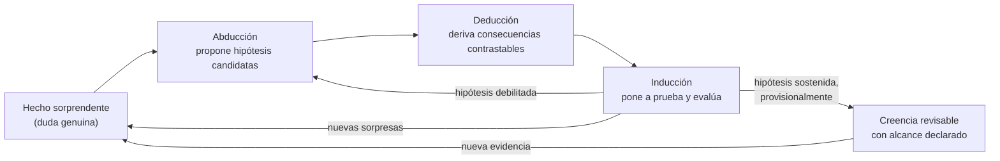

# Parte II — Abducción, deducción e inducción

[Índice](00-indice-y-estrategia.md) · Anterior: [Parte I](01-parte-I-abc.md) · Siguiente: [Parte III](03-parte-III-signos.md)

---

## 1. Advertencia inicial: dos Peirce sobre la inferencia

Peirce escribió sobre las formas de inferencia durante casi cincuenta años, y su posición cambió de manera significativa. Conviene distinguir al menos dos etapas [INTERP; Fann 1970; Anderson 1986; Burch en SEP; Bellucci 2018]:

| Etapa | Textos principales | Cómo concibe las tres inferencias |
|---|---|---|
| **Temprana** (c. 1865–1883) | Conferencias de Harvard y Lowell de 1865–1866 (W1); "On the Natural Classification of Arguments" (1867, W2:23–48); "Deduction, Induction, and Hypothesis" (1878, EP1:186–199); "A Theory of Probable Inference" (1883, W4:408–450) | Tres **tipos de argumento**, clasificados según su forma; la hipótesis y la inducción son reordenamientos de un silogismo deductivo. |
| **Madura** (c. 1898–1910) | Conferencias de Cambridge (1898, EP2); "On the Logic of Drawing History from Ancient Documents" (1901, EP2:75–114); Conferencias de Harvard sobre pragmatismo (1903, EP2:133–241); "A Neglected Argument for the Reality of God" (1908, EP2:434–450) | Tres **etapas de la investigación**: la abducción propone, la deducción explica consecuencias, la inducción pone a prueba. |

Peirce reconoció este cambio: en una carta a Paul Carus de c. 1910 dice que en casi todo lo que había publicado antes del comienzo del siglo había mezclado, en mayor o menor medida, hipótesis e inducción (CP 8.227; V2; la cita es discutida por Bellucci 2018). Por eso **citar el texto de 1878 como si fuera la teoría definitiva de Peirce sobre la abducción es un anacronismo interno**.

Además, el término cambia: en la etapa temprana dice "hipótesis"; más tarde usa "abducción" y "retroducción" (y a veces "presunción") para la misma operación, con matices.

---

## 2. La clasificación temprana: el ejemplo de los porotos (1878)

En "Deduction, Induction, and Hypothesis" (1878, *Popular Science Monthly*, sexto artículo de "Illustrations of the Logic of Science"; EP1:186–199; CP 2.619–644; V2), Peirce presenta las tres formas como combinaciones distintas de tres proposiciones: una **Regla**, un **Caso** y un **Resultado**. El ejemplo es una bolsa de porotos (en inglés *beans*):

**Deducción**
- Regla: Todos los porotos de esta bolsa son blancos.
- Caso: Estos porotos son de esta bolsa.
- ∴ Resultado: Estos porotos son blancos.

**Inducción**
- Caso: Estos porotos son de esta bolsa.
- Resultado: Estos porotos son blancos.
- ∴ Regla: Todos los porotos de esta bolsa son blancos.

**Hipótesis**
- Regla: Todos los porotos de esta bolsa son blancos.
- Resultado: Estos porotos son blancos.
- ∴ Caso: Estos porotos son de esta bolsa.

Lo que muestra el esquema [INTERP]:

- La deducción va de la regla y el caso al resultado: si las premisas son verdaderas, la conclusión también lo es.
- La inducción generaliza a partir de una muestra: infiere una regla.
- La hipótesis infiere un caso: propone que algo pertenece a cierta clase o tiene cierto origen, porque eso explicaría lo observado.
- Ni la inducción ni la hipótesis son válidas en sentido deductivo: sus conclusiones pueden ser falsas aunque las premisas sean verdaderas.

**Ejemplo forense con la misma estructura** [APLIC]:

- Regla: Todo el malware de la familia X escribe una clave de registro en `HKCU\...\Run` con el nombre `updsvc`.
- Resultado: Este equipo tiene una clave `updsvc` en esa ubicación.
- ∴ Caso (hipótesis): Este equipo fue infectado con malware de la familia X.

La debilidad es evidente: otras causas podrían producir la misma clave (otro malware que imita el nombre, software legítimo con nombre similar, una prueba de un analista). La hipótesis no es una conclusión; es una propuesta para examinar.

---

## 3. La clasificación madura: tres etapas de la investigación

En los textos posteriores a 1900, sobre todo en "A Neglected Argument for the Reality of God" (1908), Peirce describe la investigación como una secuencia de tres etapas [TEXTO, V2; EP2:440–445]:

1. **Retroducción (abducción)**: a partir de un fenómeno sorprendente, se propone una hipótesis que lo explicaría.
2. **Deducción**: se **explica** (en el sentido de explicitar, desarrollar) la hipótesis y se derivan sus consecuencias contrastables. Peirce distingue una parte de "explicación" (aclarar la hipótesis) y una de "demostración" (derivar consecuencias).
3. **Inducción**: se ponen a prueba esas consecuencias contra la experiencia, y se evalúa en qué medida la hipótesis se sostiene. Peirce distingue allí momentos de clasificación, de "probación" (las pruebas propiamente dichas) y de juicio sobre el conjunto.

El cambio clave [INTERP]: la abducción ya no es un tipo de argumento que compite con la inducción para concluir algo, sino la **etapa que introduce ideas nuevas**; la inducción no genera hipótesis, las **evalúa**.

---

## 4. Abducción

### 4.1 La formulación de 1903

En la séptima Conferencia de Harvard sobre pragmatismo ("Pragmatism and Abduction", 1903; EP2:226–241; CP 5.180–212; V2), Peirce da el esquema que se volvió canónico (CP 5.189; EP2:231):

> The surprising fact, C, is observed;
> But if A were true, C would be a matter of course,
> Hence, there is reason to suspect that A is true.

*Traducción de trabajo*:

> Se observa el hecho sorprendente C;
> pero si A fuera verdadera, C sería algo natural (algo que cabría esperar);
> por lo tanto, hay razón para sospechar que A es verdadera.

Tres detalles de redacción que importan:

1. **"Sorprendente"**: la abducción empieza con algo que rompe una expectativa, una duda genuina (Parte I, 2.7). Sin sorpresa no hay problema que explicar.
2. **"Sería algo natural"**: la hipótesis vuelve esperable el hecho. No se dice "lo causaría" ni "es la mejor explicación".
3. **"Razón para sospechar"**: la conclusión es modesta. No se afirma que A es verdadera, ni siquiera probable: se afirma que hay razón para considerarla y ponerla a prueba.

En el mismo período Peirce resume la diferencia entre las tres inferencias así: "Deduction proves that something *must* be; Induction shows that something *actually is* operative; Abduction merely suggests that something *may be*" (CP 5.171; EP2:216; V2). *Traducción de trabajo*: "La deducción prueba que algo *debe* ser; la inducción muestra que algo *es* efectivamente operativo; la abducción meramente sugiere que algo *puede* ser". Y afirma que la abducción "is the only logical operation which introduces any new idea" ("es la única operación lógica que introduce alguna idea nueva"; CP 5.172; EP2:216; V2).

### 4.2 Por qué la abducción no demuestra la verdad de la hipótesis

- **Lógicamente**, el esquema tiene la forma de lo que en lógica deductiva se llama falacia de afirmación del consecuente: de "si A, entonces C" y "C" no se sigue "A". Peirce lo sabía: por eso la conclusión es "hay razón para sospechar", no "A".
- **Epistémicamente**, muchas hipótesis distintas pueden volver natural el mismo hecho. La abducción no elimina las rivales; solo selecciona candidatas.
- **Metodológicamente**, la abducción vale por lo que permite hacer después: si una hipótesis no tiene consecuencias contrastables, no sirve como hipótesis científica, por más que "explique" el hecho [TEXTO, V2; Peirce exige que la hipótesis sea susceptible de verificación experimental; CP 5.197; EP2:235].

### 4.3 ¿Con qué criterio se elige qué hipótesis probar primero?

Peirce no dejó la abducción como pura intuición. Propuso consideraciones de **economía de la investigación** [TEXTO, V2; "Note on the Theory of the Economy of Research", 1879, W4:72–78; CP 7.139–157; y "On the Logic of Drawing History from Ancient Documents", 1901, EP2:106–114]:

| Consideración | Qué pregunta | Ejemplo forense [APLIC] |
|---|---|---|
| **Costo** | ¿Cuánto cuesta poner a prueba esta hipótesis? | Revisar un log ya recolectado es más barato que hacer una imagen forense nueva. |
| **Valor** | ¿Cuánto avanzaría la investigación si resultara verdadera o falsa? | Confirmar o descartar acceso físico cambia todo el plan; el color del fondo de pantalla, no. |
| **Relación con otras hipótesis**: cautela, amplitud, simplicidad | ¿Se puede descomponer en partes probables por separado? ¿Explica más cosas? ¿Es más simple de probar? | Probar primero "¿hubo acceso remoto?" antes que "¿fue el grupo APT-Z mediante su backdoor W?". |

Peirce compara la cautela con el juego de las veinte preguntas: conviene formular hipótesis que dividan el espacio de posibilidades de modo que cada prueba elimine mucho [TEXTO, V2; EP2:109]. Y sostiene que, a veces, conviene probar primero una hipótesis poco plausible pero barata de refutar, porque eliminarla rápido libera recursos.

Peirce también apeló a una cierta afinidad natural de la mente humana con la naturaleza (un "instinto" de adivinar bien, a veces asociado al *lume naturale* de Galileo) para explicar por qué las conjeturas humanas aciertan más de lo que el azar permitiría [TEXTO, V2; EP2:217–218; EP2:443–445]. Esta parte de su teoría es de las más discutidas [INTERP; ver Parte VIII].

### 4.4 Límites de la abducción

1. **El conjunto de hipótesis puede no contener la verdadera.** La abducción selecciona entre las que se nos ocurren. Bas van Fraassen formuló este problema, para la inferencia a la mejor explicación moderna, como el argumento del "mal lote" (*bad lot*): la mejor de un conjunto de malas hipótesis sigue siendo mala (van Fraassen 1989; V2). Es una crítica moderna, no de Peirce, aunque se aplica a la práctica abductiva.
2. **La sorpresa depende de expectativas previas.** Lo que resulta sorprendente depende de lo que el investigador ya cree. Un analista sin experiencia puede no sorprenderse ante lo anómalo, o sorprenderse ante lo normal.
3. **La explicación puede ser ad hoc.** Siempre se puede construir una hipótesis que vuelva natural cualquier hecho, si se le agregan suficientes supuestos auxiliares. La exigencia de contrastabilidad es el freno.
4. **El "instinto" no es un método.** Que los humanos conjeturen bien en general no garantiza que una conjetura particular sea buena.

---

## 5. Deducción

### 5.1 Qué es

En sentido general, la deducción es la inferencia en la que, si las premisas son verdaderas, la conclusión necesariamente lo es. En la etapa madura de Peirce, dentro de la investigación, la deducción tiene la función de **derivar consecuencias** de la hipótesis: qué tendría que observarse si fuera verdadera [TEXTO, V2; EP2:441–442].

Peirce distinguió además entre deducción **corolarial** (la conclusión se obtiene examinando directamente las premisas o un diagrama de ellas) y **teoremática** (hace falta introducir una construcción auxiliar, un experimento mental sobre el diagrama, que no está en las premisas) [TEXTO, V2; NEM 4; INTERP: Hintikka 1980; Levy 1997]. La distinción importa porque muestra que, para Peirce, la deducción no es mecánica: requiere observación de diagramas e ingenio.

### 5.2 Estructura

En la investigación, la deducción toma la forma:

- Si H es verdadera, y se dan las condiciones C, entonces debería observarse O.
- (Implícitamente: si no se observa O bajo C, entonces H, o alguno de los supuestos auxiliares, es falso.)

### 5.3 Ejemplo [APLIC]

Hipótesis H: un atacante usó la cuenta `svc_backup` para moverse lateralmente desde el servidor A al B el día D.

Consecuencias deducidas (con supuestos auxiliares explícitos):

1. Si el registro de eventos de seguridad de B estaba activo y no fue borrado, debería haber eventos de inicio de sesión de red de `svc_backup` originados en A cerca del día D.
2. Si la cuenta no se usaba normalmente de esa manera, esos eventos deberían ser atípicos respecto del historial previo.
3. Si el atacante ejecutó herramientas en B, deberían quedar rastros de ejecución (por ejemplo, artefactos de prefetch, servicios creados), salvo que se hayan eliminado.

### 5.4 Límites de la deducción

1. **La deducción no agrega información sobre el mundo**: solo explicita lo que estaba implícito en la hipótesis y los supuestos. Si la hipótesis o los supuestos son falsos, las consecuencias deducidas también pueden serlo.
2. **Los supuestos auxiliares son decisivos.** "Si el log estaba activo", "si no fue borrado", "si los relojes estaban sincronizados": cada uno puede fallar. Cuando una predicción no se cumple, no se sabe de inmediato si falla la hipótesis o un supuesto auxiliar (esto es la **tesis de Duhem**, formulada por Pierre Duhem en 1906 y radicalizada por Quine en 1951; no es de Peirce; V2).
3. **La deducción puede ser incompleta**: no siempre se derivan todas las consecuencias relevantes, y las que no se derivan no se buscan.

---

## 6. Inducción

### 6.1 Qué es

En la etapa temprana, la inducción es la inferencia de una regla general a partir de una muestra. En la etapa madura, es la **evaluación experimental de una hipótesis**: se comparan sus consecuencias con lo observado y se juzga en qué medida la hipótesis se sostiene [TEXTO, V2; EP2:442–443].

### 6.2 Tipos de inducción en el Peirce maduro [TEXTO, V2; c. 1901–1905; EP2:434–450; CP 2.755–760; INTERP: Burch en SEP]

| Tipo | Qué hace | Ejemplo [APLIC] |
|---|---|---|
| **Inducción cruda** | Generaliza a partir de la ausencia de contraejemplos en la experiencia. Es la forma más débil. | "Nunca vimos que este EDR falle en detectar Mimikatz, así que lo detecta siempre." |
| **Inducción cuantitativa** | Infiere la proporción de una característica en una población a partir de una muestra aleatoria. | "En una muestra aleatoria de 400 de los 10.000 correos de la semana, 12 eran phishing; se estima una proporción cercana al 3% con cierto margen." |
| **Inducción cualitativa** | Evalúa una hipótesis comprobando, una por una, varias de sus consecuencias cualitativas, sin muestreo numérico estricto. | Comprobar que, si la hipótesis de movimiento lateral es cierta, aparecen los artefactos 1, 2 y 3 deducidos en 5.3. |

### 6.3 La autocorrección de la inducción

Peirce sostuvo que la inducción se justifica no porque cada conclusión sea verdadera, sino porque el método, **persistido lo suficiente**, tiende a corregir sus propios errores: si la muestra es aleatoria y se amplía, la estimación tiende a acercarse al valor real [TEXTO, V2; "The Probability of Induction", 1878, EP1:155–169; "A Theory of Probable Inference", 1883, W4:408–450]. Esta tesis de la autocorrección es una de las más discutidas de Peirce (ver Rescher 1978, *Peirce's Philosophy of Science*; Levi 1980; V2). Lo que sí es claro es que la autocorrección depende de condiciones: no la tiene una práctica inductiva cualquiera.

### 6.4 Dos condiciones que Peirce exigía: aleatoriedad y predesignación

En "A Theory of Probable Inference" (1883) Peirce formula reglas para que una inferencia inductiva sea válida [TEXTO, V2; W4:408–450; CP 2.725–2.737]:

1. **La muestra debe ser aleatoria** respecto de la característica estudiada: cada miembro de la población debe tener la misma probabilidad de ser incluido, de modo que la selección no esté correlacionada con lo que se mide.
2. **La característica debe ser predesignada**: hay que decidir **antes** de examinar la muestra qué característica se va a evaluar. Si se examina la muestra primero y luego se elige la característica que aparece con frecuencia llamativa, la inferencia es inválida, porque cualquier muestra tiene alguna característica llamativa por azar.

Esta segunda regla es directamente relevante para la **selección retrospectiva** en investigación forense y en evaluación de agentes de IA (Partes VI y VII) [APLIC]. La formulación moderna de problemas parecidos (comparaciones múltiples, *p-hacking*, el "jardín de senderos que se bifurcan" de Gelman y Loken) es posterior y usa herramientas estadísticas que Peirce no tenía [V2].

Peirce, junto con Jastrow, también aplicó aleatorización y enmascaramiento en un experimento psicofísico ("On Small Differences of Sensation", 1885, *Memoirs of the National Academy of Sciences* 3: 73–83; V1): el orden de los estímulos se determinaba por un procedimiento aleatorio para que el sujeto no pudiera anticiparlo. Se lo cita como uno de los primeros experimentos aleatorizados [INTERP; Cristalli y Jackson 2023; V1].

### 6.5 Límites de la inducción

1. **Ninguna cantidad finita de casos favorables demuestra una regla universal.** Es el problema clásico de la inducción (Hume).
2. **La aleatoriedad rara vez se cumple en investigación forense**: los datos disponibles son los que quedaron, no una muestra aleatoria de lo ocurrido. Lo que sobrevive en un disco está sesgado por lo que el sistema retiene, lo que el atacante borró y lo que el analista recolectó.
3. **La predesignación es difícil de documentar**: si no se registra antes qué se va a buscar, después es casi imposible demostrar que no hubo selección retrospectiva.
4. **La inducción cualitativa depende de la deducción previa**: si las consecuencias deducidas eran triviales (las que cualquier hipótesis predice), su confirmación no discrimina.

---

## 7. Cómo se relacionan las tres formas: ciclo, no algoritmo

### 7.1 El esquema de base

### 7.2 Por qué no es un procedimiento lineal fijo [INTERP + APLIC]

1. **Las etapas se superponen.** Mientras se deducen consecuencias, aparecen nuevas sorpresas que generan nuevas abducciones. Mientras se prueba, se reformula la hipótesis.
2. **Hay abducción en todas partes.** Peirce sostuvo que incluso los juicios perceptivos tienen un componente abductivo: percibir es, en parte, interpretar (los juicios perceptivos son "un caso extremo de abducción"; EP2:227; V2). Esto implica que la "observación" de partida ya contiene interpretación.
3. **El resultado no es una verdad cerrada sino una creencia revisable.** La salida del ciclo no es un "veredicto" definitivo.
4. **El orden puede variar por economía.** A veces conviene probar primero una hipótesis poco plausible porque es barata de descartar.
5. **Hay desacuerdo interpretativo** sobre cuán sistemático es el esquema de tres etapas en Peirce. Algunos intérpretes lo leen como una teoría general de la investigación; otros señalan que Peirce lo presentó principalmente en contextos específicos (por ejemplo, el argumento de 1908) y que no lo formuló como algoritmo [INTERP; ver Anderson 1986; Bellucci 2018].

Este punto es relevante para cualquier diagrama que presente el ciclo como "abducción → deducción → inducción → conclusión" en línea recta: es una simplificación útil, pero conviene marcarla como tal (ver Parte VII, notas sobre el documento 21 del repositorio).

---

## 8. Vocabulario de la evaluación: distinciones necesarias

Muchos de estos términos **no son de Peirce**; vienen de la filosofía de la ciencia del siglo XX. Se los incluye porque son indispensables para hablar con precisión, pero hay que saber de dónde viene cada uno.

| Término | Definición de trabajo | Origen | Ejemplo forense [APLIC] |
|---|---|---|---|
| **Hipótesis plausible** | Una hipótesis que, de ser cierta, volvería natural lo observado y que no choca con lo que ya se sabe. | Cercano a Peirce (abducción); "plausible" tiene un uso técnico en Peirce tardío (CP 2.662, c. 1910; V2): una teoría hacia la que nuestro instinto se inclina antes de pruebas. | "Es plausible que el acceso haya sido mediante VPN con credenciales robadas." |
| **Mejor explicación disponible** | La hipótesis que, entre las consideradas, mejor explica los datos según ciertas virtudes (alcance, simplicidad, coherencia). | Inferencia a la mejor explicación: Harman 1965, Lipton 1991/2004. **No es la noción de Peirce** (ver 9.1). | "Entre las tres hipótesis consideradas, la del insider explica más artefactos con menos supuestos." |
| **Corroboración** | La hipótesis sobrevivió a una prueba que podría haberla refutado. No implica que sea probable. | Popper (*Bewährung*), 1934/1959. | "La hipótesis predijo que habría un evento 4624 tipo 3 en B y lo hubo." |
| **Confirmación** | La evidencia aumenta el grado de apoyo (o de probabilidad) de la hipótesis. | Hempel, Carnap; en sentido bayesiano, aumento de la probabilidad posterior. | "La aparición del binario en el servidor aumenta el apoyo a la hipótesis de compromiso común." |
| **Falsación** | Relación lógica: una observación incompatible con la hipótesis la contradice. | Popper. | "La hipótesis exige que el archivo existiera el martes; el backup del martes no lo contiene." |
| **Refutación** | Decisión metodológica de abandonar la hipótesis, a la luz de una falsación que se juzga confiable (habiendo descartado fallas en los supuestos auxiliares). | Popper, Lakatos. | "Verificado el backup y su integridad, se abandona la hipótesis." |
| **Prueba concluyente** | Evidencia que no deja lugar razonable para la hipótesis contraria. En sentido estricto, solo existe en deducción. En contextos jurídicos, se usan estándares graduados (más allá de toda duda razonable, preponderancia de la prueba). | Lógica y derecho; Peirce negaría que exista certeza absoluta en cuestiones de hecho. | Raramente disponible en DFIR. |

Observaciones:

- **Corroborar no es confirmar.** Una hipótesis puede pasar una prueba sin que eso aumente mucho su probabilidad, si la prueba era fácil de pasar (cualquier hipótesis la habría pasado).
- **Falsar no es refutar.** La falsación es lógica; la refutación requiere decidir que la observación es confiable y que no falló un supuesto auxiliar.
- **"Mejor explicación disponible" no equivale a "verdadera"**, ni siquiera a "probable", si el conjunto de hipótesis es pobre.

---

## 9. Hipótesis rivales, subdeterminación y sesgos

### 9.1 Abducción peirceana e inferencia a la mejor explicación

Desde Harman (1965), muchos autores llaman "abducción" a la **inferencia a la mejor explicación** (IBE, por *inference to the best explanation*): aceptar la hipótesis que mejor explica la evidencia. La entrada "Abduction" de Igor Douven en la SEP aclara que trata la abducción en ese sentido moderno y relega el sentido histórico peirceano a un suplemento, porque no son lo mismo [V1: registro de la entrada, primera publicación 2011, revisión sustantiva 2021].

Diferencias principales [INTERP; Campos 2011; McKaughan 2008; Douven en SEP]:

| Aspecto | Abducción en Peirce maduro | IBE moderna |
|---|---|---|
| Función | Generar hipótesis y seleccionar cuáles vale la pena **investigar** | **Aceptar** (o asignar mayor credibilidad a) una hipótesis |
| Conclusión | "Hay razón para sospechar que A" | "A es (probablemente) verdadera" |
| Etapa | Inicio de la investigación (descubrimiento y selección) | Justificación |
| Criterios | Explicatividad, contrastabilidad, economía de la investigación | Virtudes explicativas (alcance, simplicidad, coherencia, precisión) |

Daniel McKaughan (2008) propone leer la abducción peirceana como un juicio sobre **qué hipótesis merece ser perseguida** (*pursuitworthiness*), no sobre cuál es verdadera. Daniel Campos (2011) defiende la distinción entre abducción peirceana e IBE de Lipton. Otros intérpretes (por ejemplo, la lectura de Harry Frankfurt de 1958) señalaron tensiones en los propios textos de Peirce entre una abducción que inventa hipótesis y una que les da apoyo. El desacuerdo es real y no está cerrado.

**Consecuencia práctica** [APLIC]: cuando en un informe forense se escribe "por abducción se concluye que…", se está, casi siempre, usando la noción moderna de IBE, no la de Peirce. Para Peirce, la abducción no "concluye" la culpabilidad de nadie: sugiere qué investigar.

### 9.2 Hipótesis rivales

Toda abducción debe ir acompañada de la pregunta: **¿qué otras hipótesis volverían natural este mismo hecho?** En análisis de inteligencia, este principio se formalizó como Análisis de Hipótesis en Competencia (ACH, Richards Heuer, *Psychology of Intelligence Analysis*, 1999; V2): se listan todas las hipótesis razonables y se evalúa la evidencia por su capacidad de **discriminar** entre ellas, no por su compatibilidad con una sola. Es una práctica moderna compatible con el espíritu de Peirce, no derivada históricamente de él [ANALOGÍA].

### 9.3 Subdeterminación

La **subdeterminación de la teoría por la evidencia** es la tesis de que los datos disponibles pueden ser compatibles con más de una hipótesis. Se distingue una versión débil (con los datos actuales) y una fuerte (con todos los datos posibles). La discusión moderna viene de Duhem (1906) y Quine (1951), con críticas como la de Laudan y Leplin (1991) [V2].

Peirce no usa ese término, pero su respuesta implícita sería doble [INTERP]: (a) a corto plazo, elegir qué probar por economía de la investigación; (b) a largo plazo, confiar en que la investigación continuada encontrará consecuencias discriminantes. En forense, la versión débil es la habitual: no se dispone de más datos, y la respuesta correcta puede ser NO DETERMINADO (Parte VI).

### 9.4 Incertidumbre

Peirce fue uno de los primeros en tratar la probabilidad de manera frecuencial y en vincularla con la confianza en los métodos inferenciales. Sostuvo que la probabilidad se aplica a **tipos de argumentos** (con qué frecuencia un tipo de inferencia conduce de premisas verdaderas a conclusiones verdaderas), no directamente a hipótesis singulares [TEXTO, V2; "The Doctrine of Chances", 1878, EP1:142–154; "The Probability of Induction", 1878]. Por eso se mostró crítico de asignar probabilidades a hipótesis mediante probabilidades previas subjetivas (la concepción que llamaba "conceptualista") [INTERP; ver Parte VIII, bayesianismo].

### 9.5 Dependencia de las observaciones (carga teórica)

Toda observación está mediada por instrumentos, conceptos y expectativas. Norwood Russell Hanson (*Patterns of Discovery*, 1958) llamó a esto carga teórica de la observación y explícitamente reivindicó la lógica peirceana del descubrimiento [V2]. En términos de Peirce, el juicio perceptivo ya es una inferencia de tipo abductivo, aunque no la controlemos (EP2:227; V2). En forense [APLIC]: un "timestamp" no es una observación del tiempo, sino el resultado de un reloj, una zona horaria, una política del sistema de archivos y una herramienta que lo decodifica.

### 9.6 Sesgo de confirmación

El sesgo de confirmación es la tendencia a buscar, interpretar y recordar información de modo que confirme lo que ya se cree. Su estudio experimental es posterior a Peirce (Wason 1960; revisión de Nickerson 1998; V2). Peirce, sin ese vocabulario, describió algo parecido en el **método de la tenacidad** de 1877: aferrarse a una creencia evitando todo lo que podría perturbarla (Parte IV) [ANALOGÍA].

En el ciclo abductivo, el sesgo opera en tres puntos [APLIC]:

1. En la abducción: generar solo hipótesis compatibles con la que ya se prefiere.
2. En la deducción: derivar solo las consecuencias que es probable que se confirmen.
3. En la inducción: buscar solo donde se espera encontrar, y tratar la ausencia de hallazgos como irrelevante.

---

## 10. Advertencias de anacronismo

| Formulación posterior | De quién es | Riesgo al atribuirla a Peirce |
|---|---|---|
| "Inferencia a la mejor explicación" | Harman 1965; Lipton 1991 | Convierte una operación de propuesta en una de aceptación. |
| "Contexto de descubrimiento / contexto de justificación" | Reichenbach 1938 | Peirce no separó así; para él la abducción tiene una lógica, aunque débil. |
| "Falsacionismo" | Popper 1934 | Peirce valoró la refutación, pero también la inducción como autocorrectiva, que Popper rechaza. |
| "Probabilidad bayesiana de hipótesis" | Ramsey, de Finetti, Savage, bayesianismo contemporáneo | Peirce criticó la probabilidad subjetiva de hipótesis singulares. |
| "Subdeterminación" | Duhem, Quine | Peirce no usa el término; su respuesta pasa por economía y largo plazo. |
| "Sesgo de confirmación" | Wason, psicología cognitiva | Peirce describe actitudes parecidas en otro marco. |

---

## 11. Resumen de la Parte II

- Peirce cambió su teoría: de tres tipos de argumento (1878) a tres etapas de investigación (c. 1900–1908).
- La abducción propone hipótesis que volverían natural un hecho sorprendente; su conclusión es "hay razón para sospechar", no "es verdad".
- La elección de qué hipótesis probar se guía por economía de la investigación: costo, valor, cautela, amplitud, simplicidad.
- La deducción deriva consecuencias; depende de supuestos auxiliares.
- La inducción evalúa; requiere aleatoriedad y predesignación para ser válida, condiciones difíciles en forense.
- El ciclo no es un algoritmo lineal.
- La abducción peirceana no es la inferencia a la mejor explicación moderna; confundirlas es un error frecuente.

---

[Índice](00-indice-y-estrategia.md) · Siguiente: [Parte III — Teoría de los signos](03-parte-III-signos.md)
