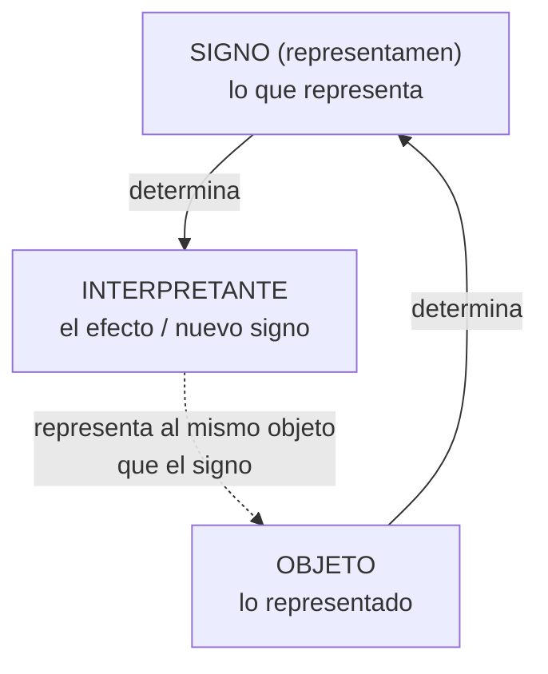

# Parte III — Teoría de los signos

[Índice](00-indice-y-estrategia.md) · Anterior: [Parte II](02-parte-II-inferencia.md) · Siguiente: [Parte IV](04-parte-IV-epistemologia.md)

---

## 1. Por qué una teoría de los signos importa para investigar

Para Peirce todo pensamiento es en signos: "We have no power of thinking without signs" ("No tenemos capacidad de pensar sin signos"; 1868, CP 5.265; EP1:30; V2). Si eso es así, la investigación es un proceso de interpretación de signos y de producción de nuevos signos. La evidencia no "habla por sí misma": es un signo que requiere interpretantes, y el informe del investigador es otro signo que será interpretado por otros.

Esta parte expone la semiótica de Peirce en tres niveles: las categorías (la base), la relación triádica del signo y la clasificación de los signos. Después la aplica a artefactos forenses y muestra cómo signos genuinos pueden sostener interpretaciones falsas.

Advertencia sobre la evolución: Atkin, en la SEP, distingue tres grandes cuentas de los signos en Peirce —una temprana (1867–1868), una intermedia (en torno a 1903) y una final (1906–1910)— y señala que, pese a los cambios, la estructura triádica básica se mantiene bastante uniforme [V1: registro de la entrada "Peirce's Theory of Signs", primera publicación 2006]. Aquí se privilegia la cuenta de 1903, que es la más usada, con indicaciones sobre la tardía.

---

## 2. Las categorías: primeridad, segundidad, terceridad

### 2.1 Origen y evolución [TEXTO + INTERP]

- En "On a New List of Categories" (1867, *Proceedings of the American Academy of Arts and Sciences* 7: 287–298; W2:49–59; EP1:1–10; V2) Peirce propone tres concepciones intermedias entre el ser y la sustancia: **cualidad**, **relación** y **representación**.
- Hacia 1885 y sobre todo en 1903 (Conferencias de Harvard, II–IV; EP2:145–178; V2) las reformula como categorías **faneroscópicas** (de *phaneron*, lo que aparece a la mente) y las nombra por orden: **primeridad**, **segundidad** y **terceridad** (*Firstness, Secondness, Thirdness*).
- Peirce sostuvo además una tesis lógica: las relaciones triádicas no pueden reducirse a combinaciones de relaciones diádicas y monádicas, mientras que las de mayor adicidad sí pueden reducirse a triádicas (la "tesis de la reducción"). Robert Burch dio una prueba formal de una versión de esta tesis en 1991 (*A Peircean Reduction Thesis*; V1).

### 2.2 Las tres categorías

| Categoría | Idea | Modo de ser | Ejemplos |
|---|---|---|---|
| **Primeridad** | Cualidad, posibilidad, sentimiento, lo que es tal como es sin referencia a otra cosa. | Posibilidad (*may-be*) | El rojo como tal; la cualidad de un sonido; la "sensación" de que algo anda raro antes de articularlo. |
| **Segundidad** | Reacción, resistencia, choque, existencia, hecho bruto: algo que es en relación con otra cosa que lo afecta. | Actualidad, existencia (*is*) | Empujar una puerta que no se abre; un evento que ocurrió en un momento y lugar; un disco que contiene ciertos bytes. |
| **Terceridad** | Mediación, ley, hábito, regularidad, representación: lo que relaciona un primero con un segundo. | Generalidad, necesidad condicional (*would-be*) | Una regla; un protocolo; el significado de una palabra; una ley natural; una política de retención de logs. |

### 2.3 Cómo ayudan a pensar la evidencia [APLIC]

- **Primeridad** es la cualidad que dispara la sospecha: "este binario se ve raro", "este correo suena extraño". Es real pero no es todavía evidencia articulada.
- **Segundidad** es el hecho bruto: estos bytes están en este disco; este paquete pasó por esta interfaz. Es lo que resiste a nuestras preferencias. Pero un hecho bruto, por sí solo, no dice qué significa.
- **Terceridad** es la regla que conecta: "si un proceso escribe en esta clave, el sistema operativo registra este evento"; "este formato de log significa que el campo 4 es la IP de origen". Sin terceridad no hay interpretación; con terceridad equivocada (una regla mal entendida), la interpretación falla aunque la segundidad sea genuina.

---

## 3. La relación triádica: signo, objeto, interpretante

### 3.1 La estructura

- El objeto **determina** al signo (lo restringe, lo condiciona).
- El signo **determina** al interpretante.
- El interpretante se relaciona con el objeto **a través** del signo: representa al mismo objeto, en algún aspecto.
- La relación es irreducible: no se puede descomponer en "signo–objeto" más "signo–intérprete" sin perder algo [TEXTO, V2; EP2:272–273, 1903].

### 3.2 Distinciones de la teoría tardía [TEXTO, V2; cartas a Lady Welby 1904–1908, EP2:477–491; INTERP: Atkin en SEP; Short 2007]

**Dos objetos**:

- **Objeto inmediato**: el objeto tal como el signo lo representa.
- **Objeto dinámico**: el objeto tal como es, que determina al signo pero que el signo no agota.

**Tres interpretantes**:

- **Inmediato**: lo que el signo es apto para significar, su interpretabilidad.
- **Dinámico**: el efecto efectivamente producido en un caso concreto.
- **Final**: el efecto que se produciría si se llevara la interpretación hasta el fin con investigación suficiente.

Hay otra tríada de interpretantes (emocional, energético, lógico) que Peirce usa en algunos textos de c. 1906–1907 (EP2:409–411, 418–419; V2), y no está claro cómo se relaciona exactamente con la anterior; es un punto de desacuerdo entre especialistas [INTERP; Short 2007; Liszka 1996].

### 3.3 Ejemplo forense de la estructura completa [APLIC]

| Elemento | En el caso de una entrada de log de autenticación |
|---|---|
| Signo | La línea de texto en `/var/log/auth.log`. |
| Objeto inmediato | "Inicio de sesión aceptado para el usuario U desde la IP X a la hora T según el reloj local." |
| Objeto dinámico | El evento real: quién o qué inició la conexión, desde dónde realmente, en qué momento real, con qué credenciales y por qué. |
| Interpretante inmediato | Lo que un lector competente del formato puede entender de la línea. |
| Interpretante dinámico | Lo que este analista concluyó al leerla hoy, en este contexto. |
| Interpretante final | Lo que se concluiría sobre esa línea si se investigara todo lo relevante (sincronización de relojes, procedencia de la IP, estado de la cuenta, integridad del log). |

La distancia entre el objeto inmediato y el dinámico, y entre el interpretante dinámico y el final, es **el espacio donde ocurren los errores de investigación**.

---

## 4. Icono, índice y símbolo

### 4.1 Definiciones [TEXTO, V2; "Nomenclature and Divisions of Triadic Relations", 1903, EP2:291–292; CP 2.247–249]

Esta tricotomía clasifica los signos según **cómo se relacionan con su objeto**:

- **Icono**: se refiere a su objeto en virtud de caracteres propios, que tendría aunque el objeto no existiera; representa por **semejanza** (en algún aspecto). Ejemplos: un dibujo, un diagrama, un mapa, una fórmula algebraica (para Peirce también es icónica en cuanto muestra relaciones).
- **Índice**: se refiere a su objeto en virtud de estar **realmente afectado** por ese objeto; hay una conexión física, causal o de contigüidad. Ejemplos de Peirce: una veleta (indica la dirección del viento), un síntoma, una huella, un pronombre demostrativo, un dedo que señala.
- **Símbolo**: se refiere a su objeto en virtud de una **ley** o hábito, normalmente una asociación de ideas generales, que hace que el símbolo sea interpretado como referido a ese objeto. Ejemplos: las palabras, los números, las convenciones de un formato de datos.

### 4.2 Los signos son mixtos

Peirce insistió en que rara vez hay un icono, índice o símbolo puro. Su ejemplo de la fotografía es clásico: una fotografía se parece a lo fotografiado (icono), pero además fue producida físicamente por la luz reflejada por el objeto (índice) [TEXTO, V2; CP 2.281; EP2:6]. Un mapa con un punto "usted está aquí" combina icono (el mapa), índice (el punto conectado con el lugar del cartel) y símbolo (las convenciones de lectura).

### 4.3 Las otras tricotomías de 1903

| Tricotomía | Pregunta | Clases |
|---|---|---|
| El signo en sí mismo | ¿Qué es el signo? | **Cualisigno** (una cualidad), **sinsigno** (un existente singular), **legisigno** (una ley o tipo) |
| Relación con el objeto | ¿Cómo representa? | **Icono**, **índice**, **símbolo** |
| Relación con el interpretante | ¿Qué tipo de interpretación produce? | **Rema** (término, posibilidad), **dicisigno** (proposición, hecho), **argumento** (razonamiento, ley) |

Combinadas con ciertas restricciones, dan **diez clases de signos** (EP2:294–296; V2). En la cuenta final (1906–1910) Peirce propuso diez tricotomías y 66 clases, cuyo desarrollo completo quedó inconcluso y sigue siendo discutido [INTERP; Atkin en SEP; Jappy 2017].

Distinción útil para forense [APLIC]: una **entrada de log concreta** es un sinsigno (un existente singular), pero es una **réplica** de un legisigno (el formato del log, que es una ley). Interpretarla exige conocer el legisigno: si el formato cambió entre versiones del software, la misma posición del campo puede significar cosas distintas.

---

## 5. Semiosis y producción de conocimiento

### 5.1 Qué es la semiosis

Como el interpretante es un signo, puede tener su propio interpretante, y así sucesivamente. Peirce llama **semiosis** a esta acción de los signos, que es triádica y, en principio, continua [TEXTO, V2; "Pragmatism", 1907, EP2:411]. Eco hablará luego de **semiosis ilimitada** para designar esta cadena (Eco 1975; 1990), y advertirá contra convertirla en licencia para cualquier interpretación (Parte VIII).

### 5.2 Semiosis e investigación [INTERP + APLIC]

La investigación puede describirse como semiosis **controlada**:

1. Un artefacto (signo) produce en el analista un primer interpretante ("esto parece un acceso no autorizado").
2. Ese interpretante, formulado como hipótesis, es un nuevo signo que se pone en relación con otros signos (otros logs, testimonios).
3. Las consecuencias deducidas son signos de lo que debería encontrarse.
4. Los hallazgos son nuevos signos.
5. El informe es un signo complejo (un argumento) dirigido a otros intérpretes (un juez, un equipo de gestión).

El control consiste en no dejar que la cadena se aleje del objeto dinámico: cada interpretante tiene que poder volver a contrastarse con algo que no dependa del propio analista (segundidad). Para Peirce, el interpretante final de una investigación correcta no es una opinión personal sino lo que se sostendría bajo investigación indefinida.

### 5.3 Un punto importante: la aserción

Para Peirce, afirmar una proposición es asumir responsabilidad por su verdad, de modo que quien afirma se expone a consecuencias si resulta falsa [INTERP; Peirce discute la aserción en varios textos tardíos, por ejemplo EP2:140–141, 1903; V2]. Esto conecta con prácticas forenses de responsabilidad del perito: un informe que "menciona" hipótesis sin afirmarlas, o que las afirma sin graduar la confianza, distribuye mal esa responsabilidad [APLIC].

---

## 6. Índice semiótico y artefacto forense: no son lo mismo

Esta distinción es central, y la consigna la pide expresamente.

### 6.1 Diferencias

| | Índice (semiótica) | Artefacto forense |
|---|---|---|
| **Qué es** | Una **función** o relación: un modo en que un signo se relaciona con su objeto (por conexión real). | Un **objeto material o registro** (bytes, archivo, entrada, dispositivo) recolectado en una investigación. |
| **Categoría** | Relacional: algo es índice de algo. | Material: algo es un artefacto, punto. |
| **De qué** | Siempre de un objeto específico con el que está realmente conectado. | Puede estar conectado causalmente con muchos objetos distintos a la vez. |
| **Garantía** | La conexión real garantiza que algo afectó al signo; no garantiza qué ni cómo. | El estatus de artefacto no garantiza nada sobre su significado. |

### 6.2 Por qué la confusión es peligrosa [APLIC]

1. **Un artefacto puede funcionar a la vez como icono, índice y símbolo.** Una captura de pantalla se parece a una pantalla (icono), fue producida por un proceso de captura (índice de ese proceso) y contiene texto que se interpreta por convención (símbolo). Decir "es un índice" sin especificar de qué es una simplificación.
2. **Un artefacto es índice de lo que lo produjo, no necesariamente de lo que dice.** Una entrada de log es índice del proceso de logging que la escribió. Que sea índice del evento que describe depende de una cadena de terceridad: configuración del sistema, formato, reglas del software. Si esa cadena falla, el artefacto sigue siendo índice (de algo) pero no del evento que se le atribuye.
3. **Un artefacto fabricado sigue siendo un índice: de su fabricación.** Un log falsificado es un índice genuino del acto de falsificarlo (alguien lo escribió). Es un símbolo falso del evento que dice representar. La pregunta forense no es "¿es un índice?" sino "¿índice de qué?".
4. **La conexión real es con el objeto dinámico, no con la interpretación.** La huella en el barro está conectada con un pie; que ese pie sea de una persona determinada es una inferencia adicional.

### 6.3 Regla operativa [APLIC]

Ante cualquier artefacto, preguntá en este orden:

1. **¿De qué proceso es índice con seguridad?** (¿qué lo produjo?)
2. **¿Qué regla (terceridad) conecta ese proceso con el evento que se investiga?**
3. **¿Esa regla vale en este sistema, en esta versión, en esta configuración, en este momento?**
4. **¿Qué otros procesos podrían haber producido el mismo artefacto?**

---

## 7. Aplicaciones a tipos de evidencia

Todas las aplicaciones de esta sección son **[APLIC]**: propuestas de esta monografía para pensar la evidencia con categorías peirceanas. No son afirmaciones de Peirce.

### 7.1 Logs

- **Dimensión indicial**: producidos por un proceso de registro en un sistema concreto.
- **Dimensión simbólica**: formato, campos y significados son convencionales (legisigno).
- **Riesgos**: formato malinterpretado; log incompleto (rotación, nivel de verbosidad); log escrito por un proceso comprometido; desfase horario.
- **Pregunta peirceana**: ¿qué hábito del sistema hace que esta línea signifique lo que creo que significa?

### 7.2 Metadatos

- **Dimensión indicial**: escritos por el software que creó o modificó el archivo, o por el sistema de archivos.
- **Dimensión simbólica**: campos estandarizados (EXIF, propiedades de documentos de oficina, atributos del sistema de archivos) cuyo significado depende de la implementación.
- **Riesgos**: metadatos heredados de una plantilla (el campo "autor" de un documento puede ser el de quien creó la plantilla original); metadatos editables por el usuario; metadatos reescritos por herramientas de sincronización.
- **Pregunta**: ¿quién o qué escribió este campo y con qué regla?

### 7.3 Timestamps

- **Dimensión indicial**: producidos por un reloj en el momento de un evento del sistema.
- **Dimensión simbólica**: zona horaria, resolución (algunos sistemas de archivos registran con resolución gruesa), significado del campo (creación, modificación, acceso, cambio de metadatos; en NTFS, distintos atributos registran tiempos distintos).
- **Riesgos**: reloj desfasado; ausencia de zona horaria (por ejemplo, campos EXIF de fecha sin desplazamiento horario en muchas cámaras); manipulación deliberada (*timestomping*, catalogado por MITRE ATT&CK como técnica T1070.006; V2); interpretación del campo equivocado.
- **Pregunta**: ¿qué evento hizo que este reloj escribiera este número, y qué tan confiable era el reloj?

### 7.4 Hashes

- **Dimensión indicial**: el valor resulta determinísticamente de los bytes.
- **Dimensión simbólica**: la equivalencia "mismo hash ⇒ mismos bytes" es una regla que depende de la resistencia a colisiones de la función (alta para SHA-256; rota para MD5 en escenarios adversariales desde 2004–2005; V2).
- **Qué demuestra un hash coincidente**: que los bytes son idénticos a los de referencia (con la confianza que dé la función).
- **Qué no demuestra**: quién creó los bytes, si el contenido es verdadero, cuándo se crearon, ni si la referencia era la correcta. **Un hash válido no demuestra la veracidad de un relato ni la autoría de un hecho.**
- **Pregunta**: ¿de qué es índice este hash? De estos bytes. Todo lo demás es inferencia adicional.

### 7.5 Testimonios

- **Dimensión indicial**: el testimonio es índice de un estado del testigo (su memoria, su percepción, sus intereses), que a su vez puede ser índice del evento.
- **Dimensión simbólica**: el lenguaje del testimonio es convencional y sujeto a ambigüedad.
- **Dimensión icónica**: las descripciones pueden funcionar como imágenes del evento.
- **Riesgos**: memoria reconstruida; contaminación por preguntas o por otros testimonios; motivación; confusión entre lo percibido y lo inferido por el testigo.
- **Pregunta**: ¿qué conexión real hay entre el testigo y el evento, y qué parte del relato es percepción y qué parte es inferencia del propio testigo?

### 7.6 Mensajes (correo, chat, redes)

- **Dimensión indicial**: el mensaje es índice de que alguien con acceso a la cuenta o al dispositivo lo produjo, y de los sistemas por los que pasó (cabeceras de correo, por ejemplo).
- **Dimensión simbólica**: contenido lingüístico, a menudo con implicaturas (Grice 1975) y con convenciones del grupo.
- **Riesgos**: cuenta comprometida; mensaje reenviado o citado fuera de contexto; cabeceras falsificables en parte; atribución por estilo sin control (estilometría con muestras pequeñas).
- **Pregunta**: ¿el mensaje es índice de la cuenta o de la persona? Son objetos distintos.

### 7.7 Capturas de pantalla

- **Dimensión icónica**: dominante; se parecen a lo que se vio en una pantalla.
- **Dimensión indicial**: débil o desconocida si no hay procedencia: la captura es índice del proceso que la produjo, que puede incluir edición, renderizado de una página falsa o composición.
- **Riesgos**: la iconicidad genera una fuerte impresión de verdad ("lo estoy viendo") que no corresponde a su débil indicialidad.
- **Pregunta**: ¿qué cadena de procesos va del evento que la captura parece mostrar hasta este archivo?

### 7.8 Telemetría

- **Dimensión indicial**: producida por sensores o agentes (EDR, sondas de red) conectados con el sistema observado.
- **Dimensión simbólica**: eventos normalizados, agregados y etiquetados por reglas del proveedor (que pueden cambiar con actualizaciones).
- **Riesgos**: cobertura parcial (lo que el agente no ve no aparece); muestreo; eventos derivados que se confunden con eventos brutos (una "alerta de comportamiento sospechoso" es un interpretante del proveedor, no un hecho bruto).
- **Pregunta**: ¿esto es un registro de lo ocurrido o una interpretación del proveedor sobre lo ocurrido?

### 7.9 Documentación (políticas, informes, tickets)

- **Dimensión simbólica**: dominante.
- **Dimensión indicial**: el documento es índice de que alguien lo escribió en algún momento; no necesariamente de que lo descrito se cumplía.
- **Riesgos**: confundir la norma ("los logs se retienen 90 días") con el hecho (qué se retuvo efectivamente); documentación desactualizada; informes que citan otros informes (dependencia de fuentes, Parte IV).
- **Pregunta**: ¿este documento describe lo que se hacía, lo que se debía hacer o lo que alguien creía que se hacía?

### 7.10 Tabla de síntesis

| Evidencia | Icono | Índice de… (seguro) | Índice de… (inferido) | Símbolo (reglas) | Error típico |
|---|---|---|---|---|---|
| Log | bajo | proceso de logging | evento descrito | formato, campos | tomar el formato por el hecho |
| Metadato | bajo | software que lo escribió | autor, momento | estándar del campo | autor de plantilla como autor |
| Timestamp | — | reloj del sistema | momento real | zona, resolución, semántica | reloj desfasado o campo equivocado |
| Hash | — | bytes | origen, autoría | resistencia a colisiones | hash ⇒ autoría |
| Testimonio | medio | estado del testigo | evento | lenguaje | inferencia del testigo como percepción |
| Mensaje | bajo | uso de la cuenta | persona | lengua, implicaturas | cuenta ⇒ persona |
| Captura | alto | proceso de captura | pantalla real | texto mostrado | iconicidad ⇒ autenticidad |
| Telemetría | bajo | sensor | evento | normalización del proveedor | interpretante del proveedor ⇒ hecho |
| Documentación | bajo | redacción | práctica real | lenguaje institucional | norma ⇒ práctica |

---

## 8. Cómo una señal verdadera puede sostener una interpretación falsa

La consigna pide mostrarlo expresamente. Los casos siguientes son sintéticos. En todos, **el signo es genuino** (no fue falsificado) y la **interpretación es falsa**.

| # | Signo genuino | Interpretación falsa | Dónde falla la cadena |
|---|---|---|---|
| 1 | Log auténtico de inicio de sesión desde una IP asignada a otro país. | "El atacante está en ese país." | La IP es índice del último salto (VPN, proxy, nodo de anonimización), no de la ubicación del operador. |
| 2 | Hash del archivo hallado coincide con el de un archivo en el equipo del sospechoso. | "El sospechoso creó el archivo." | El hash es índice de los bytes; el archivo pudo llegar por descarga, sincronización o envío. |
| 3 | Timestamp auténtico de modificación a las 02:00. | "Alguien trabajó en el documento de madrugada." | Zona horaria UTC no convertida; o modificación por un proceso automático (antivirus, sincronización). |
| 4 | Mensaje auténtico enviado desde la cuenta de la persona P. | "P escribió el mensaje." | La cuenta estaba comprometida o era compartida. |
| 5 | Captura de pantalla genuina (no editada) de una página web. | "La organización publicó eso." | La página capturada era un sitio clonado. |
| 6 | Telemetría auténtica: el EDR no registró ejecución de PowerShell. | "No se ejecutó PowerShell." | El agente estaba desactivado o no cubría ese equipo en ese período. Ausencia de registro ≠ ausencia de evento. |
| 7 | Dato estadístico verdadero: "los errores bajaron un 80%". | "La intervención redujo los errores en general." | El dato se calculó sobre un subconjunto seleccionado después de mirar los resultados (selección retrospectiva). Este ejemplo coincide en estructura con uno del documento 21 del repositorio `reward-hacking-social` (ver Parte VII). |
| 8 | Cinco informes de inteligencia independientes atribuyen un ataque al grupo G. | "La atribución a G está fuertemente corroborada." | Los cinco informes dependen de un mismo análisis original; no son independientes (Parte IV). |
| 9 | Testimonio sincero de un testigo que "vio" al sospechoso. | "El sospechoso estuvo allí." | El testigo infirió la identidad a partir de rasgos generales; percepción y reconocimiento son pasos distintos. |
| 10 | Metadato auténtico "Autor: J. Pérez" en un documento. | "J. Pérez redactó el documento." | El documento se creó a partir de una plantilla de J. Pérez. |

Patrón común [APLIC]: en todos los casos, la **segundidad** (el hecho bruto: este registro existe) es correcta, pero la **terceridad** aplicada (la regla que conecta el registro con el evento investigado) es incorrecta, incompleta o no vale en ese contexto. En términos de la sección 3: el objeto inmediato fue confundido con el objeto dinámico.

Umberto Eco formuló una idea afín cuando escribió, en el *Tratado de semiótica general* (1975), que la semiótica estudia en principio todo lo que puede usarse para mentir [V2; paráfrasis]: si algo no pudiera usarse para mentir, tampoco podría usarse para decir la verdad. Lo que este apartado agrega es que no hace falta mentir: basta con interpretar mal un signo verdadero.

---

## 9. Resumen de la Parte III

- Las categorías ofrecen tres preguntas: qué cualidad sugiere algo (primeridad), qué hecho bruto hay (segundidad) y qué regla lo conecta (terceridad).
- El signo es una relación triádica; la distancia entre objeto inmediato y dinámico, y entre interpretante dinámico y final, es donde aparecen los errores.
- Icono, índice y símbolo son modos de relación con el objeto; los signos reales son mixtos.
- "Índice" no es sinónimo de "artefacto forense": un artefacto es índice de lo que lo produjo, no necesariamente de lo que dice.
- Una señal genuina puede sostener una interpretación falsa cuando se aplica una regla de interpretación equivocada.

---

[Índice](00-indice-y-estrategia.md) · Siguiente: [Parte IV — Epistemología de la investigación](04-parte-IV-epistemologia.md)
