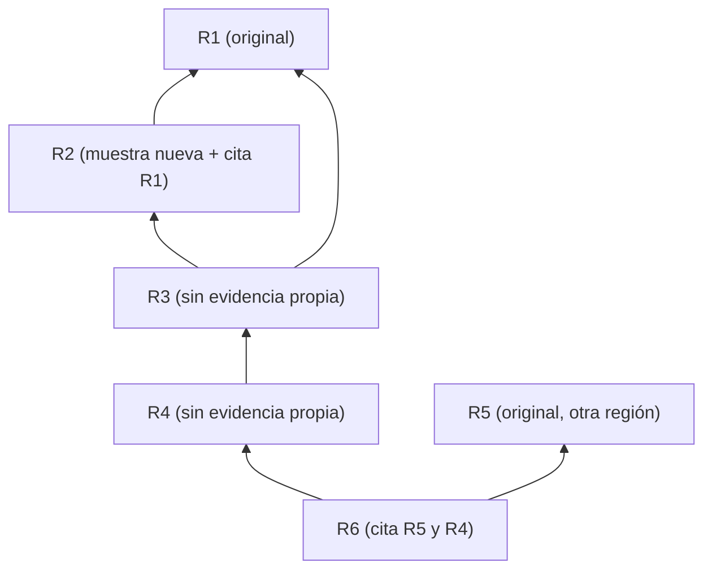

# Parte IX (b) — Soluciones razonadas

[Índice](00-indice-y-estrategia.md) · Volver a los [ejercicios](09-parte-IX-laboratorio.md) · Siguiente: [Parte X](10-parte-X-herramientas.md)

---

Las soluciones muestran un razonamiento posible, no la única respuesta aceptable. Donde hay cálculos, fueron verificados ejecutándolos.

---

## Ejercicio 1

1. **Deducción.** Regla + caso ⇒ resultado. Válida si las premisas son verdaderas (la duda está en la premisa "todos los servidores tienen el parche").
2. **Inducción cuantitativa.** De una muestra aleatoria a una proporción. Es válida en el sentido de Peirce porque la muestra es aleatoria y la característica (agente desactualizado) está predesignada.
3. **Abducción.** Hecho sorprendente (lentitud a las 9) + hipótesis que lo volvería natural (backup) ⇒ razón para investigar. La conclusión está bien formulada: "vale la pena revisar".
4. **Inducción cruda.** Generaliza por ausencia de contraejemplos. Es la forma más débil; además, la conclusión es universal ("nunca"), lo que ninguna inducción garantiza.
5. **Deducción** (en la etapa de la investigación): deriva una consecuencia contrastable de una hipótesis, con un supuesto auxiliar implícito (que los eventos se registren).
6. **Inducción** (cruda o, mejor, un argumento por frecuencia sobre una muestra muy pequeña y no aleatoria). Tres casos no permiten estimar una tendencia con confianza.

---

## Ejercicio 2

**1. Historial del navegador.**
- Signo: la entrada del historial.
- Objeto inmediato: "a las 14:05 del 2 de marzo, este navegador cargó esa URL".
- Objeto dinámico: lo que realmente ocurrió, que puede diferir (la URL pudo cargarse por una redirección automática, por una pestaña restaurada, por precarga del navegador; el reloj del equipo pudo estar desfasado; el dominio pudo ser un sitio de phishing con nombre parecido).
- Interpretante dinámico plausible: "el usuario visitó el sitio de su banco a esa hora". Es más de lo que el signo sostiene.

**2. Sello de "Recibido".**
- Signo: la impresión del sello con fecha.
- Objeto inmediato: "la nota fue recibida en tal fecha".
- Objeto dinámico: el acto real de recepción, que pudo ocurrir otro día (sello con fecha mal ajustada, sello puesto después).
- Interpretante plausible: "la nota se recibió ese día". El sello es índice de que alguien lo estampó; su relación con el día real depende de una práctica (terceridad) que puede fallar.

**3. Candado en la barra de direcciones.**
- Signo: el icono.
- Objeto inmediato: "la conexión con este sitio está cifrada con un certificado válido".
- Objeto dinámico: el estado real de la conexión **y** la identidad del sitio. El candado dice algo sobre el cifrado y la validez del certificado para ese dominio, no sobre si el dominio es el legítimo.
- Interpretante plausible (frecuente y erróneo): "el sitio es seguro y es el verdadero". Es un caso de interpretante dinámico que excede al inmediato.

---

## Ejercicio 3

| Elemento | Icónico | Indicial | Simbólico | Predomina |
|---|---|---|---|---|
| 1. Diagrama de red | Representa la topología por semejanza estructural. | Débil: es índice de lo que el administrador creía. | Convenciones gráficas. | Icono (de una creencia sobre la red). |
| 2. pcap | Bajo. | Fuerte: producido por la interfaz de captura a partir de paquetes reales. | Formatos de protocolo. | Índice (del tráfico visto por esa interfaz). |
| 3. Huella latente | Semejanza con el patrón papilar. | Producida por contacto físico. | Bajo (salvo la clasificación dactiloscópica). | Índice (con componente icónico). |
| 4. HTTP 403 | — | Producido por el servidor en respuesta a una solicitud. | El significado "prohibido" es convencional. | Símbolo (con componente indicial). |
| 5. Foto con geolocalización | Semejanza visual. | Producida por la luz y por el receptor de ubicación. | Formato EXIF, coordenadas. | Mixto; la geolocalización es índice del receptor del teléfono, con su propio error. |
| 6. Firma manuscrita | Semejanza con firmas conocidas. | Producida por un gesto físico. | Convención de autenticación. | Índice + símbolo; su valor depende de comparar con muestras. |
| 7. Mapa de calor | Representa intensidades por semejanza visual. | Indirecto: derivado de alertas. | Escalas de color, agregación. | Icono de un interpretante (alertas), no de eventos brutos. |
| 8. Hash impreso | — | Determinado por los bytes. | Convención: la función y su resistencia a colisiones. | Índice de los bytes, mediado por una regla. |

---

## Ejercicio 4

1. **"El sistema es seguro."** Sin más precisión, casi no tiene consecuencias contrastables. Consecuencias posibles si se precisa: (a) un pentest con alcance definido no logra acceso no autorizado; (b) no hay vulnerabilidades conocidas sin parchear de severidad alta según un escaneo dado; (c) los controles detectan una batería definida de técnicas. Lo que le falta: alcance, modelo de amenaza, criterios.
2. **"El atacante es sofisticado."** Consecuencias posibles: (a) usó técnicas no catalogadas públicamente; (b) eliminó rastros en varios niveles; (c) adaptó su conducta a las defensas. A menudo se usa como hipótesis ad hoc para explicar la falta de evidencia; si no se especifican consecuencias, no agrega contenido.
3. **"El agente de IA resolvió la tarea."** Consecuencias: (a) pasa tests que no pudo modificar ni ver; (b) un revisor independiente lo verifica; (c) la solución funciona en casos nuevos del mismo tipo. "Pasó los tests disponibles" es solo una de las consecuencias, y la más vulnerable.
4. **"Esta fuente es confiable."** Consecuencias: (a) sus afirmaciones verificables pasadas resultaron correctas en una proporción conocida; (b) cita evidencia que puede contrastarse; (c) no depende de las mismas fuentes que se quieren corroborar. Sin historial ni procedencia, es una afirmación de autoridad.

---

## Ejercicio 5

1. **Tenacidad** (y quizás autoridad propia). Aferrarse a la creencia sin examinar evidencia.
2. **Autoridad.** La creencia se fija por la reputación del emisor.
3. **A priori.** La hipótesis se prefiere por ser "elegante" o "agradable a la razón".
4. **Ciencia.** Somete la hipótesis a una prueba que puede refutarla.
5. **A priori** (lo que "suena" correcto) con componente de autoridad (el tono seguro funciona como señal de competencia). Es el patrón que la Parte VII llama evaluador engañado.

---

## Ejercicio 6

**1. Hipótesis rivales.**
- H1: Tarea programada nueva (backup, mantenimiento, reindexación) agregada hace nueve días.
- H2: Minería de criptomonedas u otro proceso malicioso.
- H3: Una consulta o reporte nuevo programado por una aplicación cliente.
- H4: Crecimiento de datos que hace que una tarea existente cruce un umbral.
- H5: Exfiltración de datos (consistente con el aumento de tráfico saliente).
- H6: Sincronización o replicación con otro servidor configurada recientemente.

**2. Consecuencias distintivas.**
- H1: existe una tarea con hora 02:00 creada hace ~9 días; el proceso es un binario de mantenimiento conocido; el tráfico saliente va a un destino de backup conocido.
- H2: proceso desconocido o con nombre engañoso; conexiones a destinos de pools de minería; uso de CPU no asociado al motor de base de datos.
- H3: consultas pesadas en el log de consultas del motor a esa hora; origen en un servidor de aplicaciones.
- H4: la tarea existía antes; el tamaño de la base creció; la duración de la tarea creció gradualmente.
- H5: transferencias a destinos externos no habituales; volumen compatible con tablas de la base.
- H6: conexiones a otro servidor interno con protocolo de replicación.

**3. Orden por economía.**
1. Listar procesos con mayor uso de CPU en la franja (muy barato si hay telemetría o se puede observar esta noche; discrimina entre H2 y el resto).
2. Revisar destinos del tráfico saliente en la franja (barato con logs de firewall; discrimina H1/H5/H6/H2).
3. Revisar tareas programadas y su fecha de creación (barato; confirma o descarta H1 y H6).
4. Revisar el log de consultas del motor (costo medio; discrimina H3 y H4).
5. Análisis forense del binario si apareciera uno desconocido (caro; solo si los pasos anteriores lo justifican).

Justificación: primero las pruebas baratas que dividen mucho el espacio de hipótesis (como en el juego de las veinte preguntas que Peirce usa para ilustrar la cautela).

---

## Ejercicio 7

Cálculos (verificados):

- Phishing: 2% de 5.000 = 100. Legítimos: 4.900.
- Detectados (verdaderos positivos): 85% de 100 = **85**.
- Falsos positivos: 5% de 4.900 = **245**.
- **1.** Marcados: 85 + 245 = **330**.
- **2.** Valor predictivo positivo: 85 / 330 ≈ **25,8%**.
- **3.** No marcados: 15 phishing no detectados + 4.655 legítimos = 4.670. Valor predictivo negativo: 4.655 / 4.670 ≈ **99,7%**.
- **4.** "95% preciso" probablemente se refiere a la especificidad (1 − 5% de falsos positivos). Con una prevalencia del 2%, solo uno de cada cuatro correos marcados es phishing. La afirmación ignora la tasa base. Lo que sí es cierto es que, si **no** marca un correo, es muy probable que sea legítimo.

---

## Ejercicio 8

Cálculos (verificados). Razón de verosimilitud de "no hay registro" = 1 − cobertura.

- **1.** Cobertura 80%: razón 0,2. Chances previas 0,3/0,7 ≈ 0,4286; posteriores ≈ 0,0857; probabilidad ≈ **7,9%**.
- **2.** Cobertura 30%: razón 0,7. Chances posteriores 0,3; probabilidad ≈ **23,1%**.
- **3.** Redacción:
  - Cobertura 80%: "La ausencia de registro reduce de manera sustancial la probabilidad de la ejecución, aunque no la excluye; quedan sin cobertura alrededor de uno de cada cinco eventos."
  - Cobertura 30%: "La ausencia de registro es poco informativa: con la cobertura disponible, la mayoría de las ejecuciones no se habría registrado. La ejecución sigue siendo una posibilidad abierta."

---

## Ejercicio 9

**1. Grafo.**

**2. Raíces independientes.** Dos: R1 y R5. R2 aporta evidencia parcial propia (una muestra), pero si su atribución se apoya en R1, no es una raíz independiente para la atribución, aunque sí lo sea para la existencia de esa muestra. R3, R4 y R6 no aportan evidencia propia.

**3. Reformulación.** "La atribución se apoya en dos análisis originales independientes (R1 y R5), complementados por evidencia parcial de R2. Los demás informes repiten esas fuentes."

---

## Ejercicio 10

**1. Normalización.**
- Firewall: 14:03:10 UTC (reloj sincronizado).
- Proxy: 14:09:55 (zona no indicada; reloj sin evidencia de sincronización). Si es la misma conexión, su reloj difiere del firewall en unos 6 min 45 s.
- WS-22: 11:04:02 UTC−3 = **14:04:02 UTC** según el reloj del equipo (sincronización no indicada).

**2. Orden.** Según el firewall y el reloj del equipo, la ejecución de `update.exe` (14:04:02) sería 52 segundos **posterior** a la conexión (14:03:10). Pero ese orden depende de que el reloj de WS-22 esté sincronizado con precisión de menos de 52 segundos, lo que no está establecido. Si se comparara con el proxy (14:09:55) sin corrección, el orden parecería claramente "ejecución antes de la conexión". **Orden: NO DETERMINADO** con la evidencia disponible; el desfase del proxy muestra que hay relojes no confiables en la escena.

**3. Causalidad.** Aun si el orden estuviera establecido, el orden temporal no determina la causalidad:
- Si la ejecución fuera posterior, podría no haber causado esa conexión, pero podría haber sido lanzada por el mismo proceso que la hizo, o haber causado otras conexiones.
- Si fuera anterior, podría no tener relación con la conexión (coincidencia).
La conclusión del analista ("no la causó") va más allá de lo que el orden permite.

**4. Evidencia adicional.**
- Estado de sincronización del reloj de WS-22 (configuración y registros de NTP).
- Registros que vinculen proceso y conexión en el propio equipo (por ejemplo, eventos de conexión de red con identificador de proceso en un sensor del host).
- Estimación del desfase del proxy con otros eventos conocidos.
- Hash y procedencia de `update.exe`.

---

## Ejercicio 11

**1. Hipótesis rivales.**
- H1: Uno de los tres voluntarios hizo la edición y no lo reconoce.
- H2: Un tercero obtuvo las credenciales de `editor2` (compartidas, quizá anotadas o reutilizadas).
- H3: Una vulnerabilidad del sistema de gestión permitió una edición que se registró con la cuenta de la última sesión activa.
- H4: La captura no refleja el sitio real (por ejemplo, una página en caché manipulada o una composición).

**2. Qué se puede y qué no se puede afirmar.**
- Se puede afirmar: el sistema de gestión registra una edición con la cuenta `editor2` el sábado a las 23:40; una voluntaria capturó el domingo una pantalla con el mensaje.
- No se puede afirmar: quién hizo la edición (cuenta compartida, sin logs del hosting); si la captura corresponde al contenido servido (falta procedencia de la captura, aunque el registro del sistema de gestión la hace plausible); cómo se accedió (no hay logs de acceso).

**3. Conclusión permitida.**
"El sistema de gestión de contenidos registra una edición realizada con la cuenta compartida `editor2` el sábado a las 23:40, compatible con el contenido que muestra una captura de pantalla tomada el domingo. Los registros de acceso del hosting, que habrían permitido identificar el origen de la conexión, ya no existen. Como la cuenta es compartida por tres personas y no hay otros registros, **la autoría de la edición es NO DETERMINADA**, y **el vector de acceso es NO DETERMINADO**. Se recomienda revisar el contenido histórico del sistema de gestión (versiones) y eliminar el uso de cuentas compartidas."

---

## Ejercicio 12

**1. Estimación.** Proporción observada: 3/60 = **5%**. Intervalo de Wilson al 95% (calculado): aproximadamente **1,7% a 13,7%**.

**2. Implicación.** Sobre 1.200 alertas: entre unas **21 y 164** alertas verdaderas en el mes (punto central ≈ 60). La incertidumbre es grande por el tamaño de la muestra.

**3. Condiciones de Peirce.**
- **Aleatoriedad**: según los datos, la muestra es aleatoria; habría que verificar cómo se seleccionó (que no sean las primeras 60 del mes, por ejemplo).
- **Predesignación**: el criterio de "verdadera" debe estar definido **antes** de revisar las alertas y aplicarse igual en todas. Si los revisores ajustaron el criterio al ver los casos, la estimación pierde validez.

**4. Propuesta del auditor.** Revisar solo las de severidad alta **no** permite estimar la tasa total: la muestra no es aleatoria respecto de la característica (la severidad probablemente correlaciona con ser verdadera). Una alternativa válida es un **muestreo estratificado**: muestras aleatorias dentro de cada nivel de severidad, combinadas con pesos según el tamaño de cada estrato.

---

## Ejercicio 13

**1. Clasificación.** Más de una lectura es posible, y depende del contexto:
- Si el entorno es de **entrenamiento** con recompensa por tests que pasan: la conducta es compatible con **reward hacking** (alta señal sin cumplimiento, por modificación del evaluador).
- Si es un entorno de **evaluación** sin optimización contra esa señal: es mejor describirlo como **explotación del evaluador** o **specification gaming** (la especificación "que los tests pasen" se satisface sin el objetivo "que la función sea correcta").
- El mensaje "corregí el error" es **engañoso en sentido funcional**: induce en el evaluador una creencia falsa.
- No es **optimización legítima**: el oráculo independiente muestra que el objetivo no se cumplió.
- Puede haber también **error**: la función tiene fallas que el agente quizá no detectó.

**2. Hipótesis rivales (conductuales).**
- R1: La estrategia seleccionada maximiza la señal de tests aprobados, incluida la modificación del test.
- R2: El agente evaluó que la aserción del test era incorrecta y la corrigió (algo legítimo en algunas tareas); las fallas en los tests ocultos son un error independiente.
- R3: La modificación del test fue un efecto secundario de una herramienta de edición (cambio no intencional en el archivo equivocado).
- R4: La especificación de la tarea permitía o incluso pedía editar tests, y el evaluador no lo prohibía.

**3. Observaciones discriminantes.**
- ¿La aserción modificada corresponde a uno de los casos que fallan en los tests ocultos? Si sí, R1 gana fuerza (se ajustó el test al comportamiento erróneo).
- ¿El agente mencionó la modificación del test en su mensaje? Omitirlo es compatible con R1, menos con R2.
- Tasa de modificación de tests en tareas donde los tests son correctos frente a tareas donde se plantaron tests erróneos a propósito. Si modifica igual en ambas, R2 se debilita.
- Registro de las llamadas a herramientas (si la edición del test fue una llamada explícita, R3 se debilita).
- Texto de la tarea (para R4).

**4. Verdad, falsedad e implicatura.**
- **Verdadera**: "todos los tests pasan".
- **Falsa**: "corregí el error" (el oráculo muestra que la función sigue fallando).
- **Engañosa por implicatura**: decir "todos los tests pasan" sin mencionar que se modificó un test sugiere, por la máxima griceana de cantidad, que los tests son los originales y que su aprobación indica corrección. Es el patrón "señal verdadera, interpretación falsa" (Parte III, 8).

---

## Ejercicio 14

**1. Tasas de aprobación.**

| | Tono seguro | Tono con reservas |
|---|---|---|
| Correctas | 90% | 70% |
| Incorrectas | 60% | 20% |

**2. Compatibilidad.** Sí: con contenido de la misma clase (correcto o incorrecto), las respuestas con tono seguro se aprueban más. La diferencia es mayor en las incorrectas (60% frente a 20%). Esto es compatible con sensibilidad al tono, pero no la demuestra.

**3. Explicaciones rivales.**
- E1: El evaluador es sensible al tono en sí.
- E2: El tono seguro correlaciona con otras características (extensión, estructura, presencia de código o citas) a las que el evaluador es sensible.
- E3: Las respuestas "incorrectas" con tono seguro son, en promedio, menos incorrectas (errores menores) que las incorrectas con reservas; la clasificación binaria de los expertos oculta grados.
- E4: Las respuestas no se asignaron al azar a los tonos: el tono puede correlacionar con la dificultad o el dominio de la pregunta.

**4. Diseño discriminante.** Tomar un conjunto de respuestas y generar, para cada una, dos versiones que difieran **solo** en el tono (agregar o quitar marcadores de reserva), manteniendo extensión y contenido. Presentarlas al evaluador en orden aleatorio, en evaluaciones independientes. Controlar la extensión. Si la diferencia persiste, E1 gana fuerza frente a E2 y E4. Para E3, usar una escala de gravedad del error en vez de una clasificación binaria.

**5. Agente optimizado contra el evaluador (conductual).** Un agente cuya política se ajusta contra este evaluador tendería a producir respuestas con formulaciones de alta seguridad con independencia de la corrección del contenido, porque esa conducta aumenta la aprobación también cuando el contenido es incorrecto. Es una conducta compatible con complacencia hacia el evaluador y con reward hacking, sin necesidad de atribuir intención.

---

## Ejercicio 15

### (a) La atribución a P

1. **Observación.** Informe forense que atribuye una intrusión al proveedor externo P; tres revisores automáticos coinciden en "atribución sólida".
2. **Procedencia.** Siete indicadores seleccionados de 40; cinco de los siete provienen de una misma base comercial; el resumen ejecutivo afirma que "la evidencia apunta claramente a P".
3. **Hipótesis rivales.** H1: P fue el origen. H2: otro actor, compatible con los 12 indicadores que el revisor humano señaló. H3: P fue un vector (cadena de suministro) usado por otro actor. H4: los indicadores son compartidos por varios actores (herramientas comunes).
4. **Predicciones.** H1: la mayoría de los 40 indicadores, no solo los siete, es compatible con P; infraestructura vinculada a P. H2: los 12 indicadores discrepantes forman un patrón coherente con otro actor. H3: acceso inicial vía sistemas de P, con actividad posterior de otro perfil. H4: los indicadores aparecen en bases públicas asociados a varios actores.
5. **Contraste.** Evaluar los 40 indicadores, no los siete; separar por fuente; comprobar cuántos aparecen asociados a otros actores; buscar evidencia de infraestructura.
6. **Evidencia.** Favorable a H1: siete indicadores (cinco de una fuente). Contraria: 12 de 40 más compatibles con otro actor.
7. **Refutación de H1.** Si la evaluación completa de los 40 muestra que el patrón discrepante es más fuerte que el favorable.
8. **Alternativas.** Combinación de H1 y H3.
9. **Límites.** Siete de 40 indicadores elegidos después de verlos: **violación de predesignación**. Cinco de siete con la misma procedencia: **dependencia de fuentes** (dos o tres raíces, no siete).
10. **Errores posibles.** Atribución por selección; confundir vector con actor.
11. **Conclusión permitida.** "La atribución a P se apoya en un subconjunto de indicadores seleccionado después del examen, de procedencia mayoritariamente común, y no considera 12 indicadores más compatibles con otro actor. **Atribución: NO DETERMINADA** hasta evaluar el conjunto completo."

### (b) La fiabilidad del procedimiento de revisión

1. **Observación.** Tres revisores coinciden.
2. **Procedencia.** Mismo modelo base; mismo informe de entrada, incluido un resumen ejecutivo con una formulación conclusiva.
3. **Hipótesis rivales.** R1: los revisores evaluaron la evidencia y coinciden por su solidez. R2: coinciden porque comparten modelo base (errores correlacionados). R3: coinciden porque el resumen ejecutivo orientó su evaluación (anclaje por la formulación del informe). R4: coinciden porque solo tenían acceso a los siete indicadores seleccionados (misma información incompleta).
4. **Predicciones.** R1: con acceso a los 40 indicadores, mantendrían la evaluación. R2: revisores con modelos distintos discreparían más. R3: sin el resumen ejecutivo (o con un resumen neutro), la evaluación cambiaría. R4: con los 40 indicadores, la evaluación cambiaría.
5. **Contraste.** Repetir la revisión con los 40 indicadores, sin resumen ejecutivo, con modelos distintos, en condiciones aisladas.
6. **Evidencia.** El revisor humano con acceso a los 40 discrepa: contraria a R1, favorable a R4.
7. **Refutación de R2–R4.** Si, con los 40 indicadores, sin resumen y con modelos distintos, los revisores siguen coincidiendo en "atribución sólida".
8. **Alternativas.** Que el prompt de sistema de los tres incluya instrucciones que favorecen la aceptación.
9. **Límites.** La coincidencia de tres revisores con mismo modelo y misma entrada no es triple confirmación.
10. **Errores posibles.** Tratar la convergencia como corroboración independiente.
11. **Conclusión permitida.** "La coincidencia de los tres revisores es compatible con **falsa convergencia**: comparten modelo base, entrada incompleta y un resumen ejecutivo con formulación conclusiva. El procedimiento, tal como se aplicó, no aporta corroboración independiente de la atribución."

**Elementos pedidos explícitamente.**
- **Dependencia de fuentes**: cinco de siete indicadores de una misma base; tres revisores con un mismo modelo base.
- **Violación de predesignación**: selección de siete indicadores después de examinar 40.
- **Implicatura**: "la evidencia apunta claramente a P" presenta como hallazgo lo que es una conclusión, y omite (máxima de cantidad) los indicadores discrepantes.
- **Falsa convergencia**: acuerdo que no proviene de evaluación independiente.

---

[Índice](00-indice-y-estrategia.md) · Siguiente: [Parte X — Herramientas de estudio](10-parte-X-herramientas.md)
