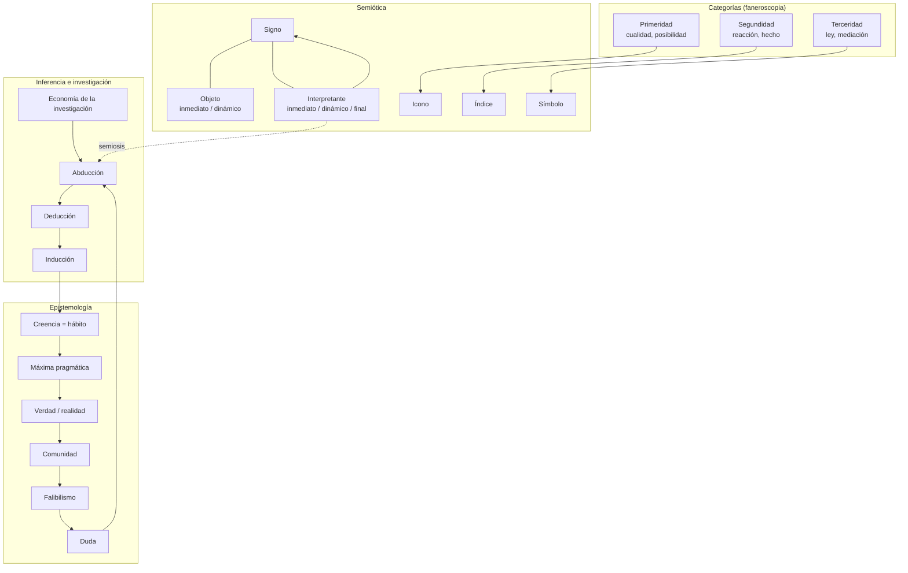

# Parte X — Herramientas de estudio

[Índice](00-indice-y-estrategia.md) · Anterior: [Parte IX](09-parte-IX-laboratorio.md) · Bibliografía: [11](11-bibliografia.md) · Procedencia: [12](12-matriz-de-procedencia.md)

---

Contenido:

1. [Glosario](#1-glosario)
2. [Cronología intelectual](#2-cronología-intelectual)
3. [Mapa de conceptos](#3-mapa-de-conceptos)
4. [Tabla de errores frecuentes](#4-tabla-de-errores-frecuentes)
5. [Matriz de tipos de inferencia](#5-matriz-de-tipos-de-inferencia)
6. [Fichas de lectura de fuentes primarias](#6-fichas-de-lectura-de-fuentes-primarias)
7. [Preguntas de investigación abiertas](#7-preguntas-de-investigación-abiertas)
8. [Itinerario de lectura gradual](#8-itinerario-de-lectura-gradual)

La bibliografía anotada está en un archivo propio: [11-bibliografia.md](11-bibliografia.md).

---

## 1. Glosario

Los términos ingleses se dan entre paréntesis. **(P)** indica término de Peirce; **(M)** término moderno o de otro autor.

| Término | Definición |
|---|---|
| **Abducción** (*abduction*) (P) | Inferencia que, ante un hecho sorprendente, propone una hipótesis que lo volvería natural; su conclusión es que hay razón para sospechar que la hipótesis es verdadera y para ponerla a prueba. También "retroducción" o, en textos tempranos, "hipótesis". |
| **Abducción creativa / hipercodificada / hipocodificada / meta-abducción** (M, Eco) | Tipología de Eco (1983) según el grado en que la regla explicativa está dada o debe inventarse; la meta-abducción conjetura que el mundo reconstruido es el real. |
| **Agapismo** (P) | Doctrina metafísica tardía de Peirce sobre el amor creativo como principio evolutivo. Contexto, no aplicado aquí. |
| **Argumento** (*argument*) (P) | En la clasificación de 1903, signo que representa su objeto como signo de una ley o proceso inferencial; el tercer término de la tricotomía rema–dicisigno–argumento. |
| **Aserción** (P) | Acto de afirmar una proposición, asumiendo responsabilidad por su verdad. |
| **Atribución** (M) | En forense, inferencia que conecta un evento con un agente responsable. |
| **Autenticidad** (M) | Que la evidencia sea lo que se dice que es y provenga de la fuente que se afirma. |
| **Autocorrección** (*self-correction*) (P) | Propiedad atribuida al método inductivo (y a la ciencia) de corregir sus errores si se persiste lo suficiente. |
| **Base rate / tasa base** (M) | Frecuencia previa de un fenómeno en la población de referencia. |
| **Cadena de custodia** (M) | Registro documentado de quién tuvo la evidencia, cuándo y qué hizo con ella. |
| **Categorías** (P) | Primeridad, segundidad y terceridad: las concepciones más generales de lo que aparece. |
| **Comunidad de investigación** (P) | Comunidad ilimitada e ideal de quienes investigan; ligada al concepto de realidad. |
| **Confirmación** (M) | Aumento del apoyo (o de la probabilidad) de una hipótesis por la evidencia. |
| **Consecuencias prácticas** (*practical bearings*) (P) | Efectos concebibles sobre la conducta y la experiencia; base de la máxima pragmática. |
| **Corroboración** (M, Popper) | Supervivencia de una hipótesis a una prueba que podría haberla refutado. |
| **Creencia** (*belief*) (P) | Estado que apacigua la duda y establece un hábito de acción. |
| **Cualisigno / sinsigno / legisigno** (P) | Signo como cualidad, como existente singular o como ley. |
| **Deducción** (P) | Inferencia necesaria; en la investigación, la etapa que deriva consecuencias contrastables de una hipótesis. |
| **Deducción corolarial / teoremática** (P) | Deducción que se obtiene directamente de las premisas, o que requiere introducir una construcción auxiliar. |
| **Dicisigno** (P) | Signo que transmite información sobre un objeto existente; corresponde aproximadamente a la proposición. |
| **Duda** (*doubt*) (P) | Estado de inquietud que motiva la investigación. **Duda genuina**: surge de la experiencia. **Duda de papel**: fingida, sin efecto sobre la investigación. |
| **Economía de la investigación** (*economy of research*) (P) | Consideraciones de costo, valor y relación entre hipótesis para decidir qué investigar primero. |
| **Error tipo I / tipo II** (M) | Falso positivo / falso negativo en una decisión binaria. |
| **Falacia del fiscal** (M) | Confundir la probabilidad de la evidencia dada la inocencia con la probabilidad de la inocencia dada la evidencia. |
| **Falibilismo** (P) | Tesis de que ninguna creencia de hecho es absolutamente cierta, exacta o universal. |
| **Falsación** (M, Popper) | Relación lógica de incompatibilidad entre una observación y una hipótesis. |
| **Faneroscopia** (*phaneroscopy*) (P) | Nombre de Peirce para su fenomenología: el estudio de lo que aparece a la mente. |
| **Hábito** (*habit*) (P) | Disposición general a actuar o reaccionar de cierta manera bajo ciertas condiciones. |
| **Hipótesis ad hoc** (M) | Hipótesis auxiliar introducida solo para salvar otra de una refutación, sin consecuencias propias. |
| **Icono** (*icon*) (P) | Signo que representa por semejanza, en virtud de caracteres propios. |
| **Índice** (*index*) (P) | Signo que representa en virtud de una conexión real (física, causal, de contigüidad) con su objeto. |
| **Inducción** (P) | Inferencia que evalúa hipótesis contra la experiencia. **Cruda**: por ausencia de contraejemplos. **Cuantitativa**: estima proporciones con muestras aleatorias. **Cualitativa**: contrasta consecuencias cualitativas. |
| **Inferencia** (P) | Adopción controlada de una creencia como consecuencia de otra, según un principio rector. |
| **Inferencia a la mejor explicación** (IBE) (M, Harman, Lipton) | Aceptación de la hipótesis que mejor explica la evidencia. Distinta de la abducción peirceana. |
| **Integridad** (M) | Que la evidencia no haya cambiado desde un momento de referencia; se verifica con hashes. |
| **Interpretante** (*interpretant*) (P) | Efecto o signo producido por un signo, que representa al mismo objeto. **Inmediato**, **dinámico**, **final**. |
| **Investigación** (*inquiry*) (P) | Lucha por pasar de la duda a la creencia; proceso de abducción, deducción e inducción. |
| **Máxima pragmática** (P) | Regla de 1878: nuestra concepción de un objeto es la concepción de sus efectos prácticos concebibles. |
| **Objeto** (P) | Lo que el signo representa. **Inmediato**: tal como el signo lo presenta. **Dinámico**: tal como es. |
| **Optimización legítima** (M, en esta monografía) | Obtener una señal de éxito alta cumpliendo el objetivo que la señal mide. |
| **Pragmatismo / pragmaticismo** (P) | Método de aclaración de significados por consecuencias concebibles; "pragmaticismo" es el nombre que Peirce adopta en 1905 para distinguirse de otras versiones. |
| **Predesignación** (P) | Requisito de definir la característica a evaluar antes de examinar la muestra. |
| **Preservación** (M) | Conservación de la evidencia sin alteración desde su recolección. |
| **Primeridad** (*Firstness*) (P) | Categoría de la cualidad y la posibilidad. |
| **Principio rector** (*leading principle*) (P) | Hábito o regla que guía una inferencia y que la lógica evalúa. |
| **Proposición** (P) | Signo que indica un objeto y afirma algo de él; puede ser verdadera o falsa. |
| **Prueba concluyente** (M) | Evidencia que no deja lugar razonable para la hipótesis contraria; estrictamente, solo en deducción. |
| **Razón de verosimilitud** (*likelihood ratio*) (M) | Cociente entre la probabilidad de la evidencia bajo una hipótesis y bajo otra. |
| **Realidad** (P) | Lo que tiene caracteres independientes de lo que cualquiera piense de ello. |
| **Realismo escolástico** (P) | Tesis de que algunos generales (leyes, hábitos, disposiciones) son reales. |
| **Refutación** (M) | Decisión metodológica de abandonar una hipótesis falsada, tras descartar fallas en supuestos auxiliares. |
| **Rema** (*rheme*) (P) | Signo que representa una posibilidad; aproximadamente, un término o predicado. |
| **Representamen** (P) | Término técnico de Peirce para el signo como primer elemento de la relación triádica. |
| **Reward hacking** (M) | Obtención de recompensa alta sin cumplir el objetivo que la recompensa pretende medir, bajo optimización. |
| **Segundidad** (*Secondness*) (P) | Categoría de la reacción, la existencia y el hecho bruto. |
| **Semiosis** (P) | Acción triádica de los signos; cadena de interpretantes. |
| **Sesgo de confirmación** (M) | Tendencia a buscar e interpretar información que confirma lo que ya se cree. |
| **Signo** (P) | Algo que representa algo para alguien en algún aspecto; relación triádica signo–objeto–interpretante. |
| **Símbolo** (*symbol*) (P) | Signo que representa en virtud de una ley o hábito de interpretación. |
| **Sinequismo** (*synechism*) (P) | Doctrina de la continuidad. |
| **Sobreinterpretación** (M, Eco) | Atribuir a los signos más significado del que sostienen. |
| **Specification gaming** (M) | Satisfacer la especificación literal de una tarea sin lograr su objetivo. |
| **Subdeterminación** (M) | Compatibilidad de una misma evidencia con más de una hipótesis. |
| **Sycophancy / complacencia** (M) | Tendencia a coincidir con creencias o preferencias del interlocutor en lugar de responder con veracidad. |
| **Terceridad** (*Thirdness*) (P) | Categoría de la mediación, la ley y la representación. |
| **Tiquismo** (*tychism*) (P) | Doctrina del azar real en la naturaleza. |
| **Verdad** (P) | Opinión a la que convergería la investigación indefinida; con varias lecturas académicas. |

---

## 2. Cronología intelectual

Datos de alta confianza en lo esencial; fechas de manuscritos y conferencias según la literatura estándar (**V2**: cotejar en W, EP o Brent 1998).

| Año | Hecho | Relevancia |
|---|---|---|
| 1839 | Nace en Cambridge, Massachusetts (10 de septiembre). | — |
| 1859 | Se gradúa en Harvard; empieza a trabajar para el Coast Survey. | Práctica de medición y error. |
| 1863 | Título en química (Lawrence Scientific School). | Formación experimental. |
| 1865–1866 | Conferencias de Harvard y Lowell sobre la lógica de la ciencia. | Primera clasificación de inferencias (W1). |
| 1867 | "On a New List of Categories"; "On the Natural Classification of Arguments". | Categorías; deducción, inducción, hipótesis. |
| 1868 | Serie anticartesiana en el *Journal of Speculative Philosophy*. | Crítica a la intuición; pensamiento en signos; comunidad. |
| 1870 | Notación para la lógica de relativos. | Lógica de relaciones. |
| c. 1872 | Metaphysical Club en Cambridge. | Gestación del pragmatismo. |
| 1877–1878 | "Illustrations of the Logic of Science" (seis artículos en *Popular Science Monthly*). | Fijación de la creencia; máxima pragmática; probabilidad; deducción–inducción–hipótesis. |
| 1878 | *Photometric Researches*. | Única monografía científica publicada como libro. |
| 1879 | "Note on the Theory of the Economy of Research". | Economía de la investigación. |
| 1879–1884 | Profesor de lógica en Johns Hopkins. | Formación de discípulos (Jastrow, Ladd-Franklin, Mitchell, Marquand). |
| 1883 | *Studies in Logic by Members of the Johns Hopkins University*, incluye "A Theory of Probable Inference". | Aleatoriedad y predesignación. |
| 1884 | Pierde el cargo en Johns Hopkins. | Fin de la carrera académica. |
| 1885 | Con Jastrow, "On Small Differences of Sensation"; "On the Algebra of Logic: A Contribution to the Philosophy of Notation". | Experimento aleatorizado; cuantificadores. |
| 1887 | Se instala en Milford, Pensilvania. | Aislamiento creciente. |
| 1891 | Termina su empleo en el Coast and Geodetic Survey. | Dificultades económicas. |
| 1891–1893 | Serie metafísica en *The Monist* ("The Architecture of Theories", "The Doctrine of Necessity Examined", "The Law of Mind", "Man's Glassy Essence", "Evolutionary Love"). | Tiquismo, sinequismo, agapismo. |
| c. 1896 | Comienza a desarrollar los grafos existenciales. | Lógica diagramática. |
| 1898 | Conferencias de Cambridge ("Reasoning and the Logic of Things"). William James presenta el pragmatismo en Berkeley atribuyéndolo a Peirce. | "No bloquear el camino de la investigación". |
| 1901 | "On the Logic of Drawing History from Ancient Documents" (manuscrito). Entradas para el *Dictionary of Philosophy and Psychology* de Baldwin (1901–1902). | Economía de hipótesis aplicada a la historia. |
| 1902 | *Minute Logic* (inconcluso). Solicitud a la Carnegie Institution, no concedida. | Proyecto de sistema lógico. |
| 1903 | Conferencias de Harvard sobre pragmatismo; Conferencias Lowell; *Syllabus*. | Esquema de la abducción; categorías faneroscópicas; diez clases de signos. |
| c. 1903–1911 | Correspondencia con Lady Victoria Welby. | Teoría tardía del signo (objetos e interpretantes). |
| 1905 | "What Pragmatism Is"; "Issues of Pragmaticism" (*The Monist*). | Pragmaticismo; realismo de los "would-be". |
| 1906 | "Prolegomena to an Apology for Pragmaticism". | Grafos existenciales y pragmaticismo. |
| 1907 | Manuscrito "Pragmatism" (MS 318). | Interpretante lógico como hábito. |
| 1908 | "A Neglected Argument for the Reality of God" (*Hibbert Journal*). | Tres etapas de la investigación. |
| 1914 | Muere en Milford (19 de abril). | — |
| 1931–1935 | *Collected Papers*, vols. 1–6. | Primera edición amplia, temática. |
| 1958 | *Collected Papers*, vols. 7–8. | — |
| 1967 | Catálogo de manuscritos de Richard Robin. | Numeración MS estándar. |
| 1982– | *Writings of Charles S. Peirce: A Chronological Edition*. | Edición crítica cronológica. |
| 1992, 1998 | *The Essential Peirce*, vols. 1 y 2. | Antología cronológica de referencia. |
| 2012 | *Obra filosófica reunida* (FCE), traducción de EP al español. | Acceso en español. |

---

## 3. Mapa de conceptos

---

## 4. Tabla de errores frecuentes

| # | Error | Por qué es un error | Dónde se trata |
|---|---|---|---|
| 1 | Citar el texto de 1878 como la teoría definitiva de Peirce sobre la abducción. | Peirce cambió su teoría después de 1900. | II, 1 |
| 2 | Identificar abducción con inferencia a la mejor explicación. | La abducción peirceana propone y prioriza; no acepta. | II, 9.1 |
| 3 | Presentar abducción–deducción–inducción como algoritmo lineal. | Las etapas se superponen y retroalimentan. | II, 7 |
| 4 | Confundir interpretante con intérprete. | El interpretante es un efecto o signo, no una persona. | I, 2.3 |
| 5 | Pensar que el significado está "dentro" del signo. | El significado depende de la relación triádica. | I, 2.1 |
| 6 | Tratar "índice" como sinónimo de "artefacto forense". | Un artefacto es índice de lo que lo produjo, no necesariamente de lo que dice. | III, 6 |
| 7 | Leer la verdad peirceana como consenso actual. | La convergencia relevante es ideal y depende de buenos métodos. | IV, 7 |
| 8 | Leer la máxima pragmática como "verdadero es lo útil". | Es una regla de aclaración de significado; Peirce rechazó la lectura utilitaria. | I, 3 |
| 9 | Confundir falibilismo con escepticismo o relativismo. | El falibilismo gradúa la confianza. | I, 2.11 |
| 10 | Usar los números de CP como si fecharan los textos. | Los CP combinaron fragmentos de épocas distintas. | 00, 4.2 |
| 11 | Tratar un hash coincidente como prueba de autoría. | El hash es índice de bytes. | V, 1 y Caso 3 |
| 12 | Tratar ausencia de registro como ausencia de evento. | Depende de la cobertura. | VI, 4 |
| 13 | Contar fuentes en lugar de raíces independientes. | Fuentes dependientes no agregan evidencia. | IV, 8.1; VI, 5 |
| 14 | Ignorar la tasa base. | Detectores precisos producen muchas falsas alarmas en poblaciones con baja prevalencia. | VI, 3 |
| 15 | Dejar que la gravedad de las consecuencias aumente la fuerza percibida de la evidencia. | El costo afecta la decisión, no la evidencia. | VI, 2.3 |
| 16 | Seleccionar los datos después de verlos y reportarlos como si se hubieran predesignado. | Viola la regla de predesignación. | II, 6.4; VI, 7.4 |
| 17 | Atribuir intencionalidad humana a los LLM al describir su conducta. | Introduce supuestos no contrastados. | VII, 1.1 |
| 18 | Tratar la explicación generada por un modelo como una observación. | Es un interpretante, no un hecho bruto. | V, Caso 12; VII, 2.10 |
| 19 | Afirmar "Peirce anticipó a Popper" (o a Bayes). | Hay coincidencias y tensiones profundas. | VIII |
| 20 | Presentar una analogía metodológica como derivación histórica. | Que algo sea compatible con Peirce no significa que provenga de Peirce. | 00, 2 |

---

## 5. Matriz de tipos de inferencia

| Dimensión | Abducción | Deducción | Inducción |
|---|---|---|---|
| **Función en la investigación** | Proponer hipótesis | Derivar consecuencias | Poner a prueba |
| **Esquema (Peirce maduro)** | Hecho sorprendente C; si A, C sería natural; hay razón para sospechar A | Si H y condiciones, entonces O | Se comparan O predichas con observadas; se juzga H |
| **Fuerza de la conclusión** | "Puede ser" | "Debe ser" (dadas las premisas) | "Es efectivamente operativo" (con cierto grado) |
| **Introduce ideas nuevas** | Sí | No | No |
| **Riesgo principal** | Hipótesis no contrastable, ad hoc o del "mal lote" | Supuestos auxiliares falsos; consecuencias triviales | Muestra no aleatoria; característica no predesignada |
| **Criterio de calidad** | Explicatividad, contrastabilidad, economía | Validez y relevancia de las consecuencias | Aleatoriedad, predesignación, tamaño |
| **Ejemplo forense** | "La regla de reenvío sugiere robo de credenciales" | "Si hubo robo, debería haber sesiones desde IP no habituales" | "En 3 de 3 consecuencias predichas, se encontró lo esperado" |
| **Error típico** | Tomar la hipótesis como conclusión | Olvidar supuestos auxiliares | Tratar la ausencia de contraejemplos como prueba |
| **Término moderno cercano (no equivalente)** | IBE (si se la usa para aceptar) | Lógica deductiva | Estadística inferencial, confirmación |

---

## 6. Fichas de lectura de fuentes primarias

Cada ficha indica: datos, tipo, ediciones (V2 salvo indicación), tesis principales, conceptos, preguntas de lectura y advertencias.

### Ficha 1 — "Some Consequences of Four Incapacities" (1868)

- **Datos**: *Journal of Speculative Philosophy* 2: 140–157. Tipo (P).
- **Ediciones**: EP1:28–55; W2:211–242; CP 5.264–317.
- **Tesis**: crítica al cartesianismo; no hay introspección ni intuición; todo pensamiento es en signos; la realidad involucra la noción de comunidad.
- **Conceptos**: duda fingida, cable vs. cadena, pensamiento-signo, comunidad.
- **Preguntas**: ¿qué significa que no tengamos intuición? ¿Por qué el concepto de realidad requiere una comunidad?
- **Advertencia**: es un texto temprano; la teoría del signo es todavía la de 1867–1868.

### Ficha 2 — "The Fixation of Belief" (1877)

- **Datos**: *Popular Science Monthly* 12 (noviembre de 1877): 1–15. Tipo (P).
- **Ediciones**: EP1:109–123; W3:242–257; CP 5.358–387. Trad. esp.: GEP (KRK); FCE 2012, tomo I.
- **Tesis**: duda y creencia; cuatro métodos de fijación; superioridad del método de la ciencia.
- **Conceptos**: principio rector, duda, creencia, investigación, tenacidad, autoridad, *a priori*, ciencia.
- **Preguntas**: ¿por qué falla cada método según Peirce? ¿Qué papel juega el "impulso social"?
- **Advertencia**: no leer "el único objeto de la investigación es asentar la opinión" fuera del argumento completo.

### Ficha 3 — "How to Make Our Ideas Clear" (1878)

- **Datos**: *Popular Science Monthly* 12 (enero de 1878): 286–302. Tipo (P). Versión francesa en *Revue Philosophique* (1879).
- **Ediciones**: EP1:124–141; W3:257–276; CP 5.388–410.
- **Tesis**: tres grados de claridad; máxima pragmática; verdad como opinión destinada; realidad.
- **Conceptos**: claridad, distinción, máxima pragmática, hábito, verdad, realidad.
- **Preguntas**: ¿qué diferencia hay entre el segundo y el tercer grado de claridad? ¿Qué problema plantea el diamante enterrado?
- **Advertencia**: Peirce revisó la posición sobre el diamante en 1905.

### Ficha 4 — "Deduction, Induction, and Hypothesis" (1878)

- **Datos**: *Popular Science Monthly* 13 (agosto de 1878): 470–482. Tipo (P).
- **Ediciones**: EP1:186–199; W3:323–338; CP 2.619–644.
- **Tesis**: las tres inferencias como combinaciones de regla, caso y resultado.
- **Conceptos**: regla, caso, resultado; hipótesis; inducción; ejemplo de los porotos.
- **Preguntas**: ¿qué tienen en común inducción e hipótesis según este texto? ¿Qué cambiará después?
- **Advertencia**: representa la teoría temprana.

### Ficha 5 — "A Theory of Probable Inference" (1883)

- **Datos**: en *Studies in Logic by Members of the Johns Hopkins University*, ed. C. S. Peirce (Boston: Little, Brown, 1883). Tipo (P). Paginación de la edición original a cotejar.
- **Ediciones**: W4:408–450; CP 2.694–754.
- **Tesis**: deducción estadística, inducción e hipótesis; reglas de muestreo aleatorio y predesignación.
- **Conceptos**: muestra aleatoria, predesignación, inferencia probable.
- **Preguntas**: ¿por qué es inválido elegir la característica después de ver la muestra?
- **Advertencia**: texto técnico; leer junto con un comentario (por ejemplo, Burch en SEP).

### Ficha 6 — Conferencias de Harvard sobre pragmatismo (1903), especialmente la VII

- **Datos**: conferencias dictadas en Harvard en marzo–mayo de 1903. Tipo (C); publicadas póstumamente.
- **Ediciones**: EP2:133–241 (VII: EP2:226–241); CP 5.14–212 (parcial y reordenado); edición de P. A. Turrisi, *Pragmatism as a Principle and Method of Right Thinking* (Albany: SUNY Press, 1997).
- **Tesis**: categorías faneroscópicas; esquema de la abducción; pragmatismo como lógica de la abducción.
- **Conceptos**: primeridad, segundidad, terceridad; abducción; juicio perceptivo.
- **Preguntas**: ¿por qué Peirce vincula el pragmatismo con la abducción? ¿Qué significa que el juicio perceptivo sea un caso extremo de abducción?
- **Advertencia**: las conferencias tienen estructura argumental propia; los CP las fragmentaron.

### Ficha 7 — "What Pragmatism Is" e "Issues of Pragmaticism" (1905)

- **Datos**: *The Monist* 15 (1905): 161–181 y 481–499. Tipo (P).
- **Ediciones**: EP2:331–345 y 346–359; CP 5.411–437 y 5.438–463.
- **Tesis**: pragmaticismo; crítica a la duda de papel; realismo de los "would-be"; sentido común crítico.
- **Conceptos**: pragmaticismo, sentido común crítico, generales reales.
- **Preguntas**: ¿qué separa el pragmaticismo de otras versiones del pragmatismo? ¿Qué corrige Peirce de 1878?
- **Advertencia**: textos densos; leer después de las fichas 2 y 3.

### Ficha 8 — "A Neglected Argument for the Reality of God" (1908)

- **Datos**: *Hibbert Journal* 7 (1908): 90–112. Tipo (P).
- **Ediciones**: EP2:434–450; CP 6.452–485.
- **Tesis**: el "juego de la meditación" (*musement*); las tres etapas de la investigación: retroducción, deducción, inducción.
- **Conceptos**: retroducción, explicación, demostración, probación.
- **Preguntas**: ¿cómo describe Peirce cada etapa? ¿Qué relación tiene la estructura con el argumento teológico?
- **Advertencia**: el contexto es teológico; la descripción de la investigación es separable, pero conviene leerla en su contexto.

### Ficha 9 — Cartas a Lady Welby (c. 1903–1911)

- **Datos**: correspondencia. Tipo (L).
- **Ediciones**: selección en EP2:477–491; *Semiotic and Significs*, ed. C. S. Hardwick (Bloomington: Indiana University Press, 1977).
- **Tesis**: teoría tardía del signo: objetos inmediato y dinámico; interpretantes inmediato, dinámico y final; clasificaciones ampliadas.
- **Preguntas**: ¿cómo cambia la definición de signo? ¿Qué papel tiene el interpretante final?
- **Advertencia**: textos epistolares, a veces tentativos.

### Ficha 10 — "On the Logic of Drawing History from Ancient Documents" (1901)

- **Datos**: manuscrito (MS 690–692). Tipo (M).
- **Ediciones**: EP2:75–114; CP 7.162–255 (parcial).
- **Tesis**: aplicación de la lógica de la abducción a la reconstrucción histórica a partir de testimonios; economía de hipótesis.
- **Conceptos**: testimonio, abducción, economía, cautela, amplitud, simplicidad.
- **Preguntas**: ¿qué criterios propone para evaluar testimonios antiguos? ¿Cómo se relacionan con el peritaje documental moderno?
- **Advertencia**: es el texto de Peirce más cercano a problemas de evidencia testimonial; especialmente relevante para esta monografía.

---

## 7. Preguntas de investigación abiertas

Preguntas de estudio que la literatura no cierra; útiles para profundizar, no para la investigación de la autora del repositorio.

**Sobre Peirce**

1. ¿Es coherente la teoría madura de la abducción con su justificación por un "instinto" de adivinar? ¿Puede naturalizarse?
2. ¿La verdad como convergencia es una definición, un criterio o una descripción del papel de la verdad en la investigación?
3. ¿Cómo se relacionan las dos tríadas de interpretantes (inmediato–dinámico–final y emocional–energético–lógico)?
4. ¿La tesis de la autocorrección de la inducción se extiende a la investigación en general?
5. ¿Qué tan unificado es el sistema de Peirce después de la edición cronológica?

**Sobre Peirce y la práctica forense**

6. ¿Puede formularse una regla de predesignación operativa para investigaciones forenses, donde la evidencia no se muestrea sino que se hereda?
7. ¿Qué forma tendría una "economía de la investigación" con costos explícitos para la respuesta a incidentes?
8. ¿La distinción entre objeto inmediato y dinámico puede traducirse en controles de redacción de informes periciales?
9. ¿Qué tipología de abducción (Eco) predomina en los errores de atribución documentados?

**Sobre Peirce e IA**

10. ¿Tiene sentido hablar de "abducción" en sistemas generativos, o es solo una metáfora?
11. ¿Cómo se adapta la noción de comunidad de investigación a sistemas donde varios agentes comparten modelo base?
12. ¿Qué significa la convergencia ideal cuando el objeto evaluado se adapta al método de evaluación?

---

## 8. Itinerario de lectura gradual

Diseñado para quien quiere **estudiar a Peirce con profundidad**, no solo aplicar sus conceptos. Cada etapa supone la anterior. No se indican tiempos.

### Etapa 1 — Orientación general

1. Una introducción de conjunto: Albert Atkin, *Peirce* (Routledge, 2015) o Cornelis de Waal, *Peirce: A Guide for the Perplexed* (Bloomsbury, 2013). En español: Sara Barrena y Jaime Nubiola, *Charles S. Peirce (1839–1914): un pensador para el siglo XXI* (Pamplona: EUNSA; año de edición a cotejar) [V1 para la existencia de la obra].
2. Las entradas "Charles Sanders Peirce" (Burch) y "Peirce's Theory of Signs" (Atkin) de la SEP.
3. La introducción de Nathan Houser a EP1 (o su traducción en *Obra filosófica reunida*, tomo I).

### Etapa 2 — Los textos de 1868 y 1877–1878

4. "Some Consequences of Four Incapacities" (1868).
5. "The Fixation of Belief" (1877).
6. "How to Make Our Ideas Clear" (1878).
7. "Deduction, Induction, and Hypothesis" (1878).
Leer en EP1 o en la traducción del GEP / FCE, con las fichas 1–4.

### Etapa 3 — Probabilidad e inducción

8. "The Doctrine of Chances" y "The Probability of Induction" (1878).
9. "A Theory of Probable Inference" (1883), con un comentario.
10. Peirce y Jastrow, "On Small Differences of Sensation" (1885), disponible en línea en *Classics in the History of Psychology* [V1].

### Etapa 4 — Semiótica

11. "On a New List of Categories" (1867).
12. "Sundry Logical Conceptions" y "Nomenclature and Divisions of Triadic Relations" (1903), EP2.
13. Cartas a Lady Welby (EP2).
14. T. L. Short, *Peirce's Theory of Signs* (Cambridge University Press, 2007).

### Etapa 5 — El Peirce maduro

15. Conferencias de Harvard sobre pragmatismo (1903), EP2.
16. "On the Logic of Drawing History from Ancient Documents" (1901), EP2.
17. "What Pragmatism Is" e "Issues of Pragmaticism" (1905).
18. "A Neglected Argument for the Reality of God" (1908).

### Etapa 6 — Debates interpretativos

19. Sobre la abducción: K. T. Fann, *Peirce's Theory of Abduction* (1970); Douglas Anderson (1986); Daniel McKaughan (2008); Daniel Campos (2011); Francesco Bellucci (2018).
20. Sobre la verdad: Cheryl Misak, *Truth and the End of Inquiry* (1991; ed. ampliada 2004); Christopher Hookway, *Truth, Rationality, and Pragmatism* (2000).
21. Biografía: Joseph Brent, *Charles Sanders Peirce: A Life* (1993; ed. revisada 1998).

### Etapa 7 — Recepción y comparación

22. Eco y Sebeok (eds.), *The Sign of Three* (1983), especialmente los capítulos de Sebeok y Umiker-Sebeok, Ginzburg y Eco.
23. Eco, *Los límites de la interpretación* (1990).
24. Popper, "Of Clouds and Clocks" (en *Objective Knowledge*, 1972).
25. Lipton, *Inference to the Best Explanation* (2.ª ed., 2004), para contrastar con la abducción peirceana.

### Etapa 8 — Fuentes avanzadas

26. *Writings of Charles S. Peirce* (W), para leer textos en su contexto cronológico y con aparato crítico.
27. *Transactions of the Charles S. Peirce Society*, revista especializada.
28. Manuscritos (catálogo Robin) para temas específicos.

---

[Índice](00-indice-y-estrategia.md) · Siguiente: [Bibliografía anotada](11-bibliografia.md)
